# HarnessWeaver Design

> **HarnessWeaver**: *The composable AI harness framework.*
> Weave your own AI harness. Bring your models. Choose your plugins. Define your execution.

This document is the architecture of HarnessWeaver: what the parts are, how they fit together, and why. It turns the design guide ([`docs/AI Harness Framework Design and Build Guide.md`](docs/AI%20Harness%20Framework%20Design%20and%20Build%20Guide.md)) into concrete decisions for this codebase.

- **Status:** a living document. Any change to the architecture updates the relevant section and, when it is a decision, adds an ADR (No. 28).
- **Rules:** [RULES.md](RULES.md) holds the invariants this design must uphold. Rule IDs (R1-R14) are cited inline.
- **User documentation:** how to use what is designed here is in the docs site under [`docs/`](docs/index.md) (`make docs` builds it), starting with [QUICKSTART.md](QUICKSTART.md). Each decision has its own record under [`docs/adr/`](docs/adr/index.md).

## Contents

1. [About this document](#1-about-this-document)
2. [Brand, names and packages](#2-brand-names-and-packages)
3. [Design goals and non-goals](#3-design-goals-and-non-goals)
4. [System context](#4-system-context)
5. [Layers](#5-layers)
6. [Core concepts](#6-core-concepts)
7. [Lifecycle and hook points](#7-lifecycle-and-hook-points)
8. [The hook bus](#8-the-hook-bus)
9. [Outcomes and guard actions](#9-outcomes-and-guard-actions)
10. [Envelope, labels and budgets](#10-envelope-labels-and-budgets)
11. [The spec system](#11-the-spec-system)
12. [Module anatomy](#12-module-anatomy)
13. [Plugins](#13-plugins)
14. [Module catalog](#14-module-catalog)
15. [Integration styles and runners](#15-integration-styles-and-runners)
16. [Models](#16-models)
17. [Tool governance](#17-tool-governance)
18. [Approvals, state and durability](#18-approvals-state-and-durability)
19. [Routing and decisions](#19-routing-and-decisions)
20. [Guardrails and validation](#20-guardrails-and-validation)
21. [Context and memory](#21-context-and-memory)
22. [Observability](#22-observability)
23. [Evals](#23-evals)
24. [Cross-language delivery](#24-cross-language-delivery)
25. [Packaging and dependency graph](#25-packaging-and-dependency-graph)
26. [Versioning and compatibility](#26-versioning-and-compatibility)
27. [Security model](#27-security-model)
28. [Architecture decision records](#28-architecture-decision-records)
29. [Deviations from the design guide](#29-deviations-from-the-design-guide)
30. [Open decisions](#30-open-decisions)

---

## 1. About this document

HarnessWeaver is a **framework that produces harnesses**. It is not one central harness that every app is routed through. Each application team uses it to assemble *its own* harness from a small core plus swappable parts, while the platform team's org baseline applies to every app and can't be removed.

| Question | Building a harness | Building HarnessWeaver |
| --- | --- | --- |
| Who is the user? | End users of one AI system | Engineers building many different AI apps |
| What ships? | A running service | Libraries, a spec format, plugins, a sidecar, a CLI, a test kit |
| Who owns control flow? | The harness | The app team, with HarnessWeaver intercepting |
| How are controls applied? | Hard-wired in one runtime | Composed per app from modules, with an org baseline that can't be removed |
| What must stay stable? | The service API | The extension contracts: hook points, ports, spec format |
| What does success look like? | One system is reliable | A new team gets tracing, budgets, guardrails, tool governance and evals in under a day, without rewriting its app |

**Who writes what**

- **HarnessWeaver ships:** the spec format, the runtime core (lifecycle, budgets, hook bus, error taxonomy), standard modules, plugins for popular frameworks and model APIs, a sidecar for other languages, a CLI, templates and a test kit.
- **The platform or security team ships:** an org baseline profile (mandatory controls, locked values, bounds) and approved plugins.
- **Each app team writes:** a `harness.yaml`, its prompts, its tools and any app-specific plugins. It keeps whatever executor it already uses: raw SDK calls, Pydantic AI, LangGraph or a custom loop.

## 2. Brand, names and packages

The design guide used the working name `harnesskit`. That name is taken on PyPI and npm by unrelated projects, so the framework ships as **HarnessWeaver** (ADR-0001).

| Package | Registry | Language | What it is |
| --- | --- | --- | --- |
| `harnessweaver` | PyPI | Python | Core: spec loader, hook bus, envelope, budgets, errors, runners, the 12 modules with dependency-free default providers, and the test kit. `import harnessweaver as hw` |
| `harnessweaver-cli` | PyPI | Python | Developer tooling. Installs the `harnessweaver` command (init, spec, doctor, hooks, test, eval, policy, replay, add, tools, plugin, sidecar, gateway, dev, contracts) |
| `harnessweaver-sidecar` | PyPI + container | Python | `harnessd`, the HTTP sidecar that serves the Python core to other languages |
| `harnessweaver-<name>` | PyPI | Python | First-party plugins: `harnessweaver-openai`, `-anthropic`, `-pydantic-ai`, `-monty`, `-otel`, `-cel`. Third-party plugins can use any package name (No. 13) |
| `@harnessweaver/core` | npm | TypeScript | Native TypeScript core for the Session style: spec loader, hook bus, budgets, built-in guards, cel-lite, routing, tool governor, context, prompts, eval graders, sidecar client (ADR-0040) |
| `@harnessweaver/<name>` | npm | TypeScript | First-party TypeScript plugins, e.g. `@harnessweaver/ai-sdk` |

Wire and file formats use the brand too: `apiVersion: harnessweaver/v1`, `HARNESSWEAVER_*` env vars, and the `harnessweaver.plugins` entry-point group. The spec file keeps the neutral name `harness.yaml`, because it describes *a harness*.

## 3. Design goals and non-goals

Every feature request is tested against these ten goals. **When two goals conflict, the earlier one wins.**

1. **Safe by default, removable by nobody.** Org baseline controls (tracing, budgets, PII redaction, tool policy) apply automatically and can't be switched off by app config. (R1, R2)
2. **Non-invasive.** HarnessWeaver wraps whatever the app already uses. Adopting it never requires rewriting an agent or switching frameworks.
3. **Incremental.** Each adoption level (observe, guard, govern, orchestrate, improve) is useful on its own. One line of code gets you level 0.
4. **Composable.** Every capability is a module behind a port. Apps pick modules; modules pick providers.
5. **Declarative first, code when needed.** Common setup is a YAML spec. Anything the spec can't express is a plain Python or TypeScript function registered as a plugin.
6. **Small core.** The core depends only on Pydantic, the OpenTelemetry API, PyYAML, anyio and loguru. Everything heavy is a plugin. (R6)
7. **Polyglot by contract.** One spec format and one set of wire contracts serve Python, TypeScript and any language that can call HTTP. (R11)
8. **Testable.** Every module runs against fakes. Every plugin passes a shared conformance suite. (R14, T5)
9. **Stable extension surface.** Hook points, ports and the spec are versioned and change slowly. Internals can change freely. (V1-V5)
10. **Observable.** Every decision HarnessWeaver makes (route chosen, guard fired, tool denied, budget hit) is a traced, queryable event. (R13)

**Non-goals.** HarnessWeaver is not an agent framework, a prompt library, a vector database, a model host or a hosted platform. It does not pick an app's model, prompt, retrieval method or workflow. It ships plugins for the tools that do those jobs and governs them. (R12)

## 4. System context

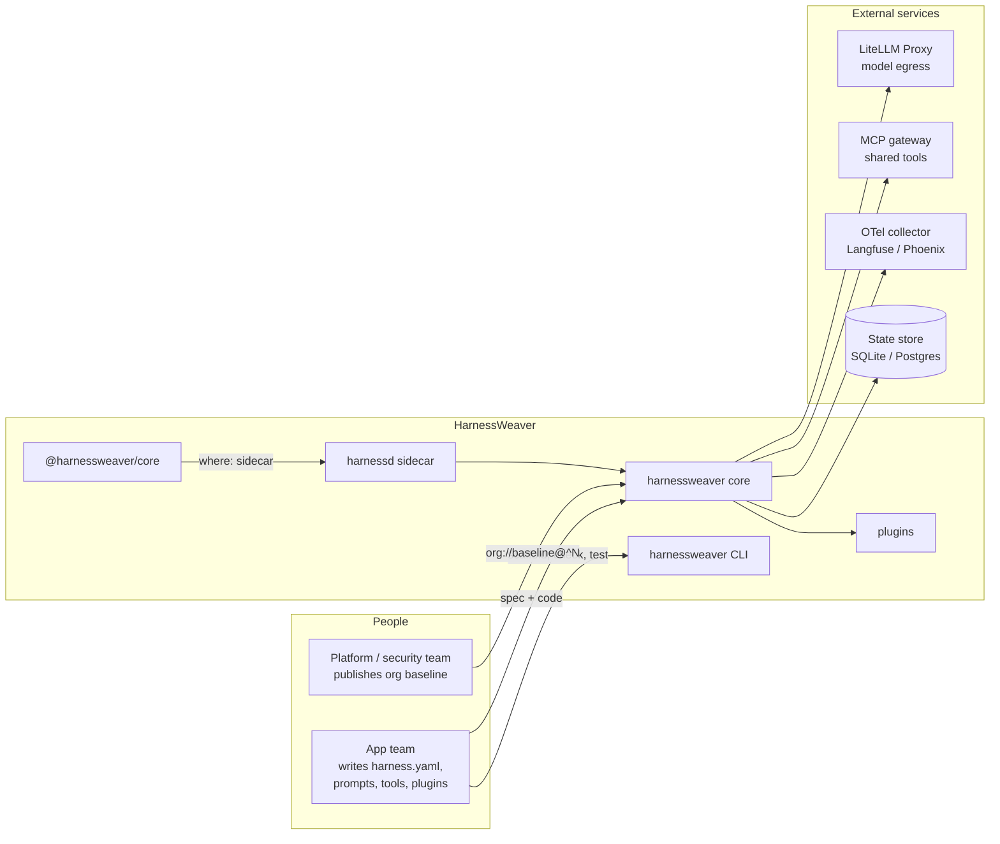

## 5. Layers

App teams touch only the top layer and their spec. Everything below it is shipped by HarnessWeaver or the platform team. The core is deliberately small: it owns lifecycle and policy, and delegates all reasoning to whatever runner the app chose.

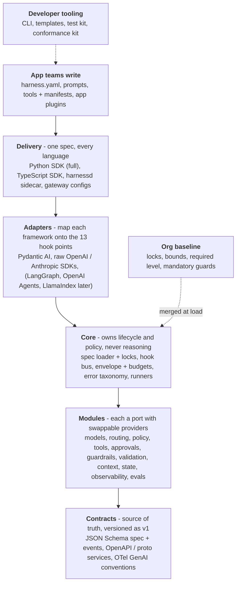

The guide's original rendering of the same model is in [`docs/assets/mental_model.png`](docs/assets/mental_model.png).

## 6. Core concepts

App developers learn twelve concepts. Everything else is an implementation detail of a module.

| Concept | What it is | Defined by | Code |
| --- | --- | --- | --- |
| **Harness** | The runtime object an app creates from a spec. Exposes `run`, `session`, `wrap` and `instrument`. | HarnessWeaver, built from the app's spec | `harnessweaver.Harness` |
| **HarnessSpec** | The declarative definition of one app's harness, usually `harness.yaml`. | App team | `harnessweaver.spec.HarnessSpec` |
| **Profile** | A reusable partial spec. Built-in ones (`extraction`, `rag`, `agent`, `workflow`, `chat`) preset modules; the org baseline is also a profile. | HarnessWeaver, platform team | `harnessweaver.spec.Profile` |
| **Task** | A named, versioned unit of work with input and output schemas, a runner and task-level overrides, such as `extract_invoice@3`. | App team | `spec.tasks.<name>` |
| **Envelope** | The immutable context carried through every call: run id, tenant, principal, task, budget, deadline, labels. | HarnessWeaver, filled from the request | `harnessweaver.Envelope` |
| **Hook point** | A named moment in the lifecycle (`model.before`, `tool.before`, ...). Modules attach behavior here. | HarnessWeaver (fixed, versioned set of 13) | `harnessweaver.HookPoint` |
| **Middleware** | A function attached to one or more hook points. It can observe, modify, block, retry, escalate or suspend. | Modules, app plugins | `@hw.middleware` |
| **Port** | A typed interface for one capability: `Decider`, `Guardrail`, `PolicyEngine`, `ToolGovernor`, `ModelProvider`, ... | HarnessWeaver | `harnessweaver.core.ports` |
| **Provider** | A concrete implementation of a port, such as `pii.regex` for `Guardrail`. Contributed by a plugin. | HarnessWeaver, third parties, app teams | `@hw.provider` |
| **Module** | A bundle that wires one capability end to end: its port, a default provider, the middleware it installs and its config schema. | HarnessWeaver | `harnessweaver.modules.*` |
| **Runner** | The adapter that executes a task: `direct`, `session`, `workflow`, `pydantic_ai.agent`, or a custom one. Runners don't implement controls; hook points do. | HarnessWeaver, app teams | `@hw.runner` |
| **Plugin** | A package or module that contributes providers, middleware, routing stages, runners, adapters, profiles or templates through one contract, whatever its name (No. 13). | HarnessWeaver, third parties, app teams | `hw.Plugin` |

**The key relationship:** a **spec** selects **modules**. Each module configures a **provider** behind its **port** and installs **middleware** on **hook points**. The **runner** emits hook events as the task executes, and every event carries the **envelope**.

## 7. Lifecycle and hook points

HarnessWeaver's most important contract is a fixed set of **13 hook points**. Every runner and adapter maps its own events onto these, so one guardrail or policy works unchanged across raw SDK calls, Pydantic AI or any other framework.

Each hook point has a **direction**:
- **Inbound** hooks fire on the way *into* an operation and run outermost-first.
- **Outbound** hooks fire on the way *out* and run innermost-first.

| Hook point | Direction | Fires when | Middleware may | Typical modules |
| --- | --- | --- | --- | --- |
| `run.start` | inbound | Envelope built, before any work | Reject, check idempotency, set budget and deadline | identity, budgets, observability |
| `input.before` | inbound | Raw input arrives | Validate schema, redact, block | guardrails (input), validation |
| `route.decide` | inbound | A choice is needed: task variant, runner, model alias, pipeline | Return a `Decision` | routing |
| `context.after` | outbound | Retrieval or memory returns items | Filter by ACL, label provenance, drop, cap size | context, guardrails (context) |
| `model.before` | inbound | A model request is about to be sent | Modify messages, pick a model alias, pre-check budget, block | budgets, guardrails, models |
| `model.after` | outbound | A model response arrives | Record usage and cost, redact, block, retry | budgets, observability |
| `stream.chunk` | inbound | A streamed chunk arrives (optional) | Buffer, moderate, cut the stream | guardrails (output) |
| `tool.before` | inbound | The model proposes a tool call | Allow, deny, rewrite args, require approval | tools, policy, approvals |
| `tool.after` | outbound | A tool returns | Sanitize, truncate, label untrusted | tools, guardrails |
| `output.before` | inbound | A candidate final output exists | Validate, repair, escalate, block | validation, guardrails (output) |
| `approval.resolved` | inbound | A human answers a suspended step | Re-authorize edited args, resume or end | approvals |
| `run.error` | outbound | Any exception escapes a step | Classify into the error taxonomy, retry or fail | core |
| `run.end` | outbound | The run reaches a terminal state | Persist, emit completion, sample for evals | state, evals, observability |

### A run, end to end

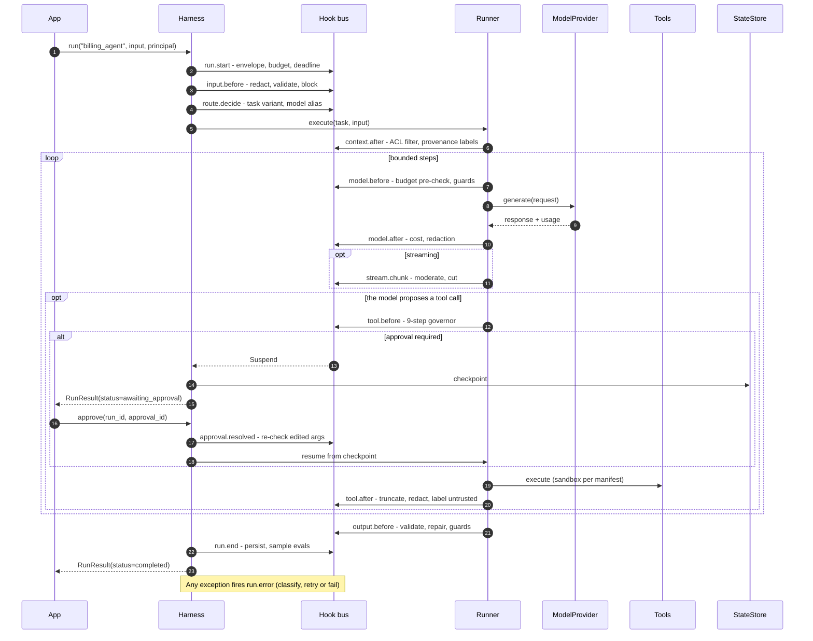

## 8. The hook bus

The bus is the one shared piece every app runs unchanged. Its ordering rules make the result predictable when many modules act on one event.

### Rules

1. **Priority bands.** Middleware runs in bands: `baseline` (org, locked, outermost), then `platform`, then `app`, then `task`. Within a band, registration order applies.
2. **Onion order.** Inbound hooks run outermost-first (baseline -> task). Outbound hooks run innermost-first (task -> baseline). A baseline tracer therefore wraps everything inside it.
3. **Most severe outcome wins** when several middleware answer the same event: `Block` > `Suspend` > `Escalate` > `Retry` > `Continue(modified)` > `Continue`.
4. **Fail mode is declared, never implied.** If a middleware raises or times out, `fail_mode="closed"` turns that into `Block`; `fail_mode="open"` logs, alerts and continues. Baseline middleware is always closed (R2).

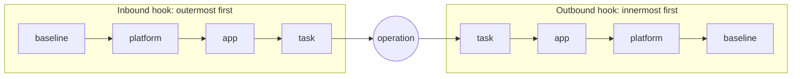

### Algorithm

```python
async def emit(hook: HookPoint, payload: Event, ctx: RunContext) -> HookResult:
    chain = registry.middleware_for(hook)            # sorted by (band, registration order)
    if hook.direction is Direction.OUTBOUND:
        chain = list(reversed(chain))
    outcomes: list[Outcome] = []
    for mw in chain:
        try:
            with anyio.fail_after(mw.timeout):
                outcome = await mw(payload, ctx.envelope) or Continue()
        except Exception as exc:                    # includes timeouts
            outcome = mw.on_failure(exc)            # closed -> Block, open -> Continue + alert
        ctx.trace.record(hook, mw, outcome)         # R13: every outcome is traced
        outcomes.append(outcome)
        if isinstance(outcome, Continue) and outcome.modified is not None:
            payload = outcome.modified              # modifications chain inward/outward
        if isinstance(outcome, Block):
            break                                   # nothing can outrank Block
    return HookResult(outcome=most_severe(outcomes), payload=payload)
```

A middleware is a small async function or class:

```python
import harnessweaver as hw

@hw.middleware(hooks=["tool.before"], band="app", fail_mode="closed", timeout="2s")
async def no_weekend_refunds(event: hw.ToolCallEvent, env: hw.Envelope) -> hw.Outcome:
    if event.tool.name == "refund_payment" and env.clock.is_weekend():
        return hw.Suspend(reason="weekend refunds need approval", approver_role="finance")
    return hw.Continue()
```

**Details** (fixtures suite `bus`):
- Returning `None` means `Continue()`. Returning something that isn't an outcome, or modifying the payload into another hook's payload type, is a failure, handled by the fail mode.
- A closed failure becomes `Block` with code `middleware_error`, or `middleware_timeout` when the middleware's `timeout` ran out. The trace records the exception's type, never its message (R9).
- The trace has one `outcome` (or `failure`) event per middleware, then one `hook` event with the combined outcome. So it shows every hook point that fired, even with no middleware attached.
- The band in `@hw.middleware` is a default. The spec's `middleware:` item assigns the real band, and only profiles may assign `baseline` (S8). Baseline middleware that fails open is a load error (R2). A class middleware is built from its `config` model with the item's other keys; its default name is the class name in snake_case.

## 9. Outcomes and guard actions

Middleware returns one of six outcomes. Guardrails speak a richer vocabulary of **seven actions**, which the guardrails module maps onto outcomes.

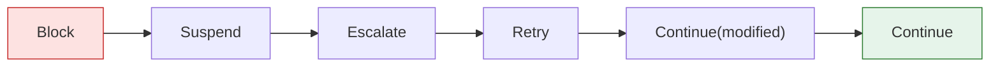

*Most severe on the left. When outcomes are combined, the leftmost one wins.*

| Outcome | Meaning | Runner behavior |
| --- | --- | --- |
| `Continue()` | Proceed unchanged | - |
| `Continue(modified=...)` | Proceed with a changed payload (redacted text, rewritten args) | Later middleware and the operation see the new payload |
| `Retry(reason)` | Redo the step (bounded) | `model.after` re-asks; `output.before` runs a repair attempt |
| `Escalate(reason, to)` | Stop the automated path and hand off to a human queue | Run ends `escalated` |
| `Suspend(reason, approver_role)` | Pause durably until an approver answers | Checkpoint, then `awaiting_approval` |
| `Block(reason, code)` | Refuse | Run ends `blocked`; the step never executes |

`Retry` is honored at `model.after` (the model is asked again, once) and at `output.before` (a repair, up to `validation.max_repairs`). Anywhere else it becomes `Block` with code `retry_not_supported`. `Suspend` pauses at `tool.before` and `output.before` (No. 18). Anywhere else, and in a standalone session, it escalates.

| Guard action | Maps to | Notes |
| --- | --- | --- |
| `allow` | `Continue()` | |
| `redact` | `Continue(modified=...)` | Redactions chain through the pipeline |
| `repair` | `Retry` | Output stage only, bounded by `max_repairs` |
| `escalate` | `Escalate` | |
| `require_approval` | `Suspend` | |
| `block` | `Block` | |
| `log_only` | `Continue()` + a "would have fired" trace event | Shadow mode (R8) |

### Error taxonomy

Only taxonomy errors cross a public boundary (C5). Each has a stable code that travels as `ErrorInfo` in `run.error` events and over the wire.

| Code | Errors | Retryable |
| --- | --- | --- |
| `budget_exceeded` | `BudgetExceeded` | no |
| `deadline_exceeded` | `DeadlineExceeded` | no |
| `policy_denied` | `PolicyDenied` | no |
| `validation_failed` | `ValidationFailed` | no |
| `provider_error` | `ProviderError` | yes |
| `tool_error` | `ToolError` | no |
| `expression_error` | `ExpressionSyntaxError`, `ExpressionEvalError` | no |
| `spec_invalid` | `SpecError` and its load-time subclasses: `LockViolation`, `BoundViolation`, `LevelTooLow`, `UnreachableHook`, `IncompatibleContract`, `UnknownProvider`, `PluginConflict`, `PluginNotAllowed` | no |
| `not_found` | `NotFound`: an unknown task, run or approval | no |
| `blocked`, `escalated`, `suspended` | `RunBlocked`, `RunEscalated`, `RunSuspended`, all `RunInterrupted`: a hook halted the run (ADR-0020). `details` holds the `hook` and the `Block` code | no |
| `internal` | `InternalError` (anything unexpected) | no |

Error messages and details never contain raw prompts, outputs, tool arguments or variable values (R9).

## 10. Envelope, labels and budgets

The **Envelope** is immutable (`frozen=True`). The mutable state of a run lives in its `RunContext`, which produces a new envelope whenever labels or budgets change.

| Field | Meaning |
| --- | --- |
| `run_id`, `parent_run_id` | Identity of this run and the run that spawned it |
| `tenant`, `principal` | Who the run acts for. `Principal` has `id`, `roles`, `attrs` |
| `task`, `task_version` | The task being executed |
| `budget` | Snapshot of the remaining budget |
| `deadline` | Absolute deadline (from `budget.deadline`) |
| `labels` | Data class plus provenance flags: `untrusted_seen`, `private_seen`, and a `sources` list |
| `idempotency_key` | Caller-supplied key for safe retries |
| `trace_id` | Correlates with OpenTelemetry |
| `attributes` | Free-form app tags such as channel or region |
| `clock` | Injected clock (`now()`, `is_weekend()`), so time is testable (C4) |

**Labels drive the lethal-trifecta check (S3).**
- `untrusted_seen` becomes true once retrieved context or tool output labelled `untrusted` enters the run.
- `private_seen` becomes true once a tool with `data_access: [pii:*]` runs, or a guard reports a finding marked `private` (as `pii.regex` does for the PII it finds), wherever the guard runs.
- A tool with external egress, called while both flags are set, needs approval or is blocked.

**Budgets** (`max_usd`, `max_tokens`, `max_model_calls`, `max_tool_calls`, `deadline`) are enforced at fixed points:

| Check | Hook | Behavior |
| --- | --- | --- |
| Pre-check estimated cost of the next call | `model.before` | `Block(code="budget_exceeded")` if it would overflow |
| Record actual usage and cost | `model.after` | Updates the meter; blocks if exceeded |
| Count tool calls | `tool.before` | Governor step 5 |
| Deadline | whole run | `anyio.fail_after`; on expiry the run fails with `DeadlineExceeded` |

**Cost** is resolved in this order (ADR-0012):
1. The cost the provider reports (for example LiteLLM's response-cost header).
2. Spec `models.prices`.
3. The `genai-prices` package, if installed *(planned)*.
4. Otherwise `unknown`. This is flagged on the trace and never guessed.

**Budget details** (fixtures suite `budgets`):
- The pre-check at `model.before` blocks when the call count, tokens or cost has reached its limit, or when the request's estimated input (one token per four characters) won't fit in the tokens left. A call is counted when it goes ahead.
- `model.after` adds the actual usage and cost; going over `max_tokens` or `max_usd` blocks the run.
- Each check, and each call's usage and cost source, is traced as a `harness.budget` event (R13).
- A runner or adapter must reach `model.before` and `model.after` when a model limit is set, and `tool.before` when `max_tool_calls` is set. Otherwise loading fails (R4).
- While a run waits for approval its deadline is paused: the resumed run gets the time it had left.

## 11. The spec system

### Layers

Effective config is merged in this order. Later layers override earlier ones, except where a value is locked or bounded.

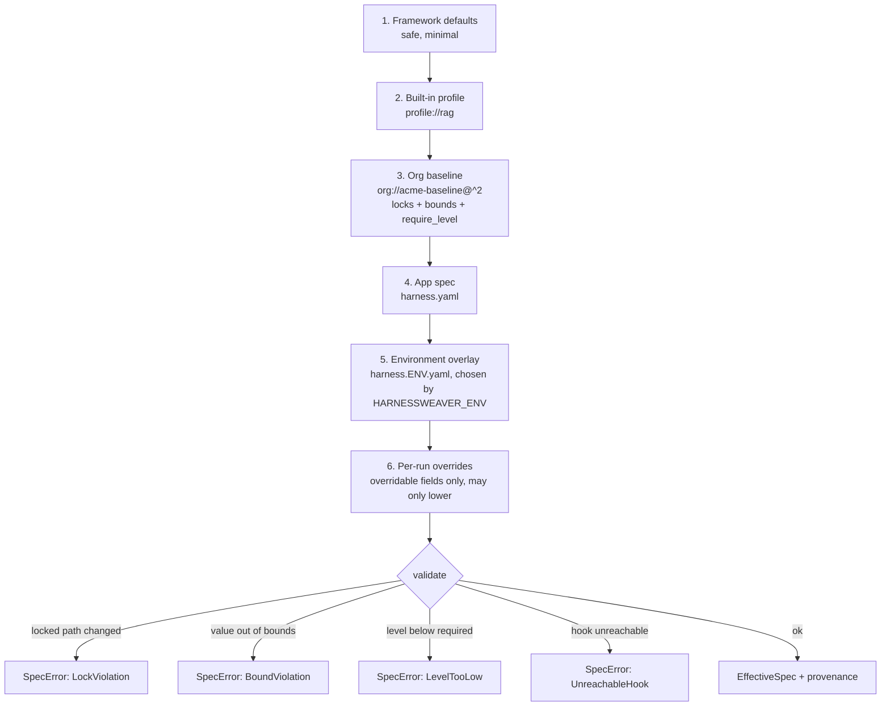

### Documents

Specs are YAML 1.2 (core schema), read the same way in every language: `no`, `on` and `2026-01-05` stay strings, and a repeated key is an error (ADR-0017).

| Document | `kind` | Allowed top-level keys |
| --- | --- | --- |
| App spec (`harness.yaml`) | `Harness` | `apiVersion`, `kind`, `metadata`, `extends`, and the sections |
| Profile (built-in, plugin or org) | `Profile` | The same, plus `locks`, `bounds` and `require_level` |
| Environment overlay (`harness.<env>.yaml`) | `Overlay` (optional) | Sections only; no `metadata`, `extends`, `locks`, `bounds` or `require_level` |

Any other key fails loading (R4). Profile `metadata` describes the profile and is never merged into the app's. An overlay that doesn't exist is not an error; `spec explain` lists the layers that were applied.

Sections that pick a provider with `use:` (guards, routing stages, context sources, middleware, runners, `models`, `policy`, `approvals`, `state`, `observability`) keep the provider's own settings next to `use:`. Those settings are validated against the provider's config model when the harness loads, so unknown keys still fail (R4).

### Merge rules

| Value type | Rule | Example |
| --- | --- | --- |
| Scalar | The later layer wins unless locked | App sets `models.default: fast` |
| Map | Merged key by key | App adds `context.kb` beside baseline settings |
| Plain list | Replaced by the later layer | `routing.<r>.options` |
| Keyed list | Merged by `id`. A known id updates that item in place; new items are appended; earlier items keep their position and can't be removed. Later items run *inside* earlier ones | App's injection guard runs inside the baseline's `base-pii` |
| Item without an `id` | Appended, then given `<use>#<n>` (`rule#<n>` in rule lists, `item#<n>` otherwise), skipping ids already taken | `pii.regex#1` |
| `null` | Unsets a scalar. Can't remove a map or a keyed list, or a value a bound gives a maximum (except one the framework defaults left in place) | `models.default: null` |
| Type change (map vs. scalar) | Replaces the whole subtree, unless that would change a locked value | Rare; usually a mistake |
| Locked path | Changing it, or anything under it, is a load error (R1). Restating the same value is allowed (ADR-0018) | `observability.capture_content: true` fails |
| Locked list item `path[id]` | Changing that item is a load error; other items can still be added | `guardrails.input[base-pii]` |
| Locked list `path` | The list can't change or grow | `guardrails.input` |
| Wildcard lock | `*` and `[*]` cover every key or item, including ones added later | `guardrails.input[*]`, `tasks.*.budget` |
| Bounded number or duration | A value outside the bound is a load error, never a clamp (R10). Bounds from several profiles all apply | `max_usd: 8.00` fails against `max: 5.00` |
| Task budgets | Also checked against the `budgets.per_run.<field>` bounds | A task can't exceed the org's per-run cap |
| Per-run override | Only fields listed in the task's `budget.overridable`, only downward, and still within bounds | A caller can lower `max_usd`, never raise it or remove it |

The keyed lists are `guardrails.<stage>`, `middleware`, `routing.<router>.cascade`, `policy.rules`, `validation.rules` and `tasks.<task>.guardrails.<stage>`. Shorthands are expanded before merging: `runner: session` becomes `runner: { use: session }`, and a single `tools.manifests` glob becomes a list. Lock and bound paths use `a.b[id].c`, with `*` matching any map key and `[*]` any item. The `merge` conformance suite pins down every rule above.

A layer's own locks bind only later layers, so profiles the app's team can write merge after the platform's, whatever order `extends` lists them in (ADR-0043). The first directory on the search path holding a name owns it. A locked `where: sidecar` guard needs a lock covering `sidecar.url`. Only profiles can put middleware in the `baseline` band (S8). Every cel-lite rule is compiled when the spec loads, against the names it may use: `principal`, `tenant`, `task`, `tool`, `args` and `labels` for `policy.rules`, and `output`, `input` and `task` for `validation.rules`. A typo therefore fails at load, not mid-run (R4).

**Provenance.** Every effective value remembers the layer and file it came from. `harnessweaver spec explain` prints it, with locks and bounds. `harnessweaver spec diff` compares two specs, including locks, profile layers and the adoption level, and runs in CI on every PR. A `git:` side is loaded from that ref's own tree.

**Adoption level.** `levels.py` computes the level the effective spec reaches. Levels are cumulative, and each requirement has a stable code (the `levels` conformance suite):

| Level | Code | Requirement |
| --- | --- | --- |
| L0 Observe | - | Observability is always on |
| L1 Guard | `L1.enforcing_guardrail` | At least one enabled guardrail with `mode: enforce` |
| L1 Guard | `L1.task_outputs` | Every task declares an `output` (`str` for plain text) |
| L2 Govern | `L2.require_manifest` | `tools.require_manifest` is true |
| L2 Govern | `L2.run_budget` | `budgets.per_run` sets at least one limit |
| L2 Govern | `L2.policy_rules` | `policy.rules` has at least one rule |
| L3 Orchestrate | `L3.tasks` | At least one task is defined |
| L4 Improve | `L4.task_evals` | Every task has at least one eval suite |

The baseline's `require_level` picks the required level by `metadata.risk_tier`. A spec below it fails to load with `LevelTooLow`, which lists the missing requirement codes.

### Spec shape (abridged)

```yaml
apiVersion: harnessweaver/v1
kind: Harness                         # or Profile
metadata: { name: support-assistant, owner: cx-team, risk_tier: customer_facing }
extends: [ "org://acme-baseline@^2", "profile://rag" ]
plugins:     { local: [ "app.harness_plugin" ], allow: [ openai, acme ] }   # allow is usually locked by the org baseline
models:      { provider: openai.chat, default: fast, aliases: { fast: fast-chat, strong: strong-chat }, prices: { fast-chat: { input_per_mtok: 0.15, output_per_mtok: 0.60 } } }
middleware:  [ { use: acme.no_weekend_refunds, band: app } ]
routing:     { intent: { options: [ billing, other ], cascade: [ { use: lexical, utterances: { billing: [ refund my order ] } } ], default: other } }
context:     { kb: { use: memory, file: data/kb.yaml, label: untrusted, max_items: 5, max_tokens: 2000 } }
memory:      { use: memory, default_ttl: 30d }
guardrails:  { input: [ { use: pii.regex, action: redact } ], context: [], tool_result: [], output: [], stream: [] }
validation:  { max_repairs: 1, on_failure: escalate, rules: [ { when: "output.total < 0", message: "the total can't be negative" } ] }
tools:       { manifests: [ "tools/*.tool.yaml" ], require_manifest: true }
policy:      { use: cel_lite, rules: [ { when: "args.amount_usd > 100", effect: require_approval } ] }
approvals:   { use: memory, timeout: 24h, on_timeout: escalate }
budgets:     { per_run: { max_usd: 2.00, deadline: 5m } }
state:       { use: sqlite, path: .harness/state.db, record: false }   # record: keep runs for replay
observability: { configure_sdk: true, exporter: otlp, endpoint: "http://otel-collector:4318", capture_content: false }
evals:       { invoice: [ evals/golden.yaml ], online: { sample_rate: 0.05, graders: [ schema_valid ] } }
tasks:       { invoice: { version: 1.0.0, runner: direct, output: "app.schemas:Invoice", budget: { max_usd: 0.50 } } }
# Profiles only:
require_level: { default: L1, tiers: { customer_facing: L2, takes_actions: L3 } }
locks:  [ observability.capture_content, "guardrails.input[base-pii]" ]
bounds: { budgets.per_run.max_usd: { max: 5.00 }, tasks.*.budget.max_tool_calls: { max: 50 } }
```

The JSON Schemas `contracts/schemas/harness.schema.json` and `profile.schema.json` describe complete documents. Profiles and overlays are partial, so an editor may flag a profile that only tweaks part of a section.

The built-in profiles are `defaults` (always the first layer), `extraction`, `rag`, `agent`, `workflow` and `chat`.

## 12. Module anatomy

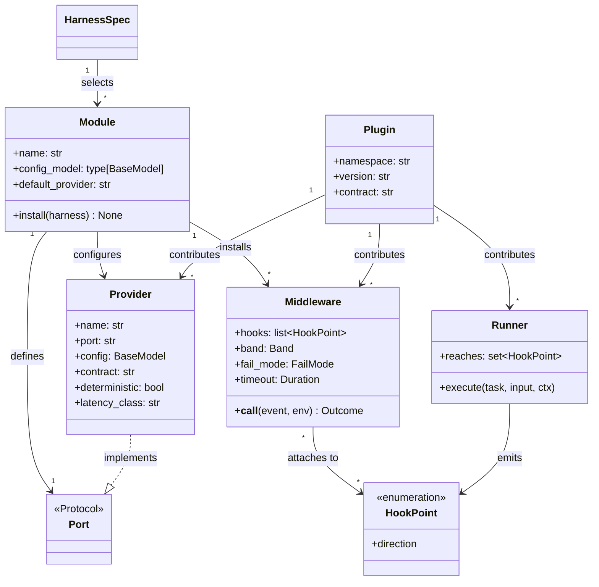

A provider is a class that satisfies a port, plus a Pydantic config model so the loader can validate its settings:

```python
from pydantic import BaseModel
import harnessweaver as hw

class InHousePIIConfig(BaseModel):
    endpoint: str
    entities: list[str] = ["EMAIL", "PHONE"]

@hw.provider(port="Guardrail", name="acme.pii", config=InHousePIIConfig,
             contract=">=1.0,<2", stages=["input", "tool_result", "output"],
             deterministic=True, latency_class="fast")
class InHousePII:
    def __init__(self, cfg: InHousePIIConfig) -> None:
        self.client = AcmePIIClient(cfg.endpoint)
        self.entities = cfg.entities

    async def check(self, content: str, env: hw.Envelope) -> hw.GuardResult:
        hits = await self.client.scan(content, self.entities)
        if not hits:
            return hw.GuardResult.allow()
        return hw.GuardResult.redact(self.client.mask(content, hits), findings=hits)
```

Providers, middleware, routing stages, runners and adapters reach a harness through a **plugin** (No. 13).

## 13. Plugins

> **A module becomes a plugin by how it is designed, not by what it is called.**

HarnessWeaver ships the plugins most apps need: model providers, the Pydantic AI adapter, sandboxing, OTel export and full CEL. Anyone can build more plugins in their own repository and use them with no change to HarnessWeaver. First-party and third-party plugins use **the same contract**. The plugins in this repository get no private hooks into the core, and the core registers its own built-in providers through that contract too.

### What makes something a plugin

A plugin is any importable Python module that exposes a `harnessweaver.Plugin` object, made discoverable in one of two ways:

- **Installed packages** declare it in the `harnessweaver.plugins` entry-point group. The entry-point name is the plugin's **namespace**.
- **In-repo code** lists the module under `plugins.local` in `harness.yaml`.

There is no package naming convention. `harnessweaver-openai`, `acme-harness` and `my_company.guards` are all valid plugin packages.

```python
# acme_harness/__init__.py
import harnessweaver as hw
from acme_harness import guards, middleware

plugin = hw.Plugin(
    namespace="acme",                       # owns every name acme.*
    version="1.2.0",
    contract=">=1.0,<2",                    # contract range it was built against (V5)
    providers=[guards.InHousePII],          # @hw.provider classes, for any port
    middleware=[middleware.no_weekend_refunds],
    profiles={"baseline": "profiles/baseline.yaml"},
)
```

```toml
# acme-harness/pyproject.toml
[project.entry-points."harnessweaver.plugins"]
acme = "acme_harness:plugin"
```

```yaml
# an app's harness.yaml
guardrails:
  input: [ { use: acme.pii, action: redact, mode: log_only } ]
middleware:
  - { use: acme.no_weekend_refunds, band: app }
```

### What a plugin can contribute

| Contribution | Declared with | Selected in the spec by |
| --- | --- | --- |
| Providers for any port (`Guardrail`, `ModelProvider`, `PolicyEngine`, `Sandbox`, ...) | `@hw.provider` | `use: acme.pii` in the module's section |
| Middleware | `@hw.middleware` | `middleware: [{ use: acme.no_weekend_refunds, band: app }]` |
| Routing stages | `@hw.decider` | `cascade: [{ use: acme.vip_rules }]` |
| Runners | `@hw.runner` | `tasks.<t>.runner: { use: acme.flow }` |
| Adapters | `@hw.adapter` | Picked by `harness.wrap()` / `harness.instrument()` from the target's type |
| Profiles | `profiles={...}` | `extends: ["profile://acme.baseline@^1"]` |
| Templates | `templates={...}` | `harnessweaver init --template acme.rag` |

### Names and namespaces

- Every contributed name is `<namespace>.<name>`, where the namespace is the plugin's entry-point name (`acme.pii`, `openai.chat`). This lets the loader find the owning plugin **without importing anything**.
- The core's built-in plugin owns bare names (`direct`, `session`, `workflow`) and a small set of reserved area namespaces (`pii`, `secrets`, `regex`, `injection`, `size`, `topic`, `grounded`, `llm`, `cel_lite`, `rules`, `lexical`, `semantic`, `memory`, `sqlite`, `scripted`, ...), listed in `harnessweaver.RESERVED_NAMESPACES`. Other plugins can't claim them.
- Loading fails (R4) if two installed plugins claim the same namespace, or if a referenced name resolves to nothing.
- Names are lowercase words joined by dots. Names are unique per port, so `memory` can be both a state store and an approval channel.
- A plugin can ship profiles. `profile://acme.baseline@^1` imports only the `acme` plugin, and `plugins.allow` applies to it like any other use.
- The built-in plugin is always imported from the core itself and is always allowed. `PluginCatalog.problems()` lists namespaces that are shared or reserved, for `harnessweaver doctor`.

### Loading lifecycle

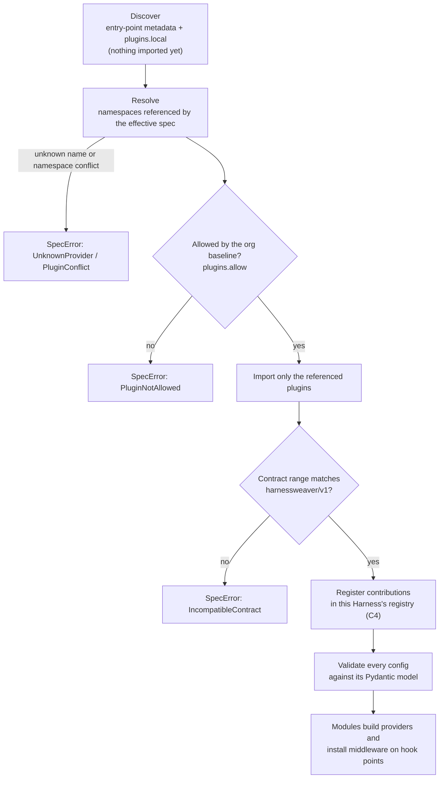

### Trust rules

- **Installing is not enabling.** Installing a plugin activates nothing. Only names referenced by the effective spec are imported and used. Plugin modules must not do I/O or register anything at import time.
- **The spec assigns bands, not the plugin.** A plugin can't put its middleware in the `baseline` band; only the org baseline profile can (R1, R2).
- **Org allow-lists.** A baseline can lock which plugins apps may use: `plugins: { allow: [openai, anthropic, acme] }`.
- **Compatibility and conformance.** Plugins declare the contract range they were built against (V5) and pass the conformance suite (T5).

### Building a plugin in your own repository

1. `harnessweaver plugin new acme` scaffolds a standalone package: a `pyproject.toml` with the entry point, a `Plugin` object, a sample guard, and tests whose `pytest` run includes the conformance suite. A CI workflow in the scaffold is *planned*.
2. Build against the **public extension surface** only:
   - `harnessweaver.Plugin` and the decorators
   - the port Protocols in `harnessweaver.ports`
   - the contract models
   - `harnessweaver.testing`

   This surface is versioned with the contract (V1, V2), so a plugin keeps working across core releases within `harnessweaver/v1`.
3. Run `pytest --harnessweaver-conformance=acme` (see *Conformance* below).
4. Publish under any name. Apps `uv add` the package and reference `acme.*` in `harness.yaml`. `harnessweaver plugin list` shows each installed plugin, its namespace, version and whether its contract range is compatible.

### Conformance

Installing `harnessweaver` adds a pytest plugin (through the `pytest11` entry point; it does nothing unless asked). `pytest --harnessweaver-conformance=<namespace>` collects a suite shipped in `harnessweaver.testing` that checks one plugin: an installed namespace, `harnessweaver` for the built-in plugin, or `module:attribute` for an in-repo one (T5). The checks are plain functions in `harnessweaver.testing.conformance`, so they also run outside pytest.

| Check | Applies to |
| --- | --- |
| Metadata: entry point, contract range (V5), names in the namespace, profiles and templates exist | the plugin |
| Importing it opens no sockets, writes no files and installs no global OpenTelemetry provider (S8) | the plugin |
| Builds from its config model alone, or from its declared `sample` settings (C11) | every contribution |
| Results validate against the port's contract (a state store also passes a round-trip contract) | guardrails, deciders, model providers, state stores |
| Fresh instances give the same results for the same input | `deterministic=True` providers |
| A guard that runs past its timeout blocks when it fails closed, and is cancellable | guardrails |
| A canary string passed through never reaches logs, spans or traces (R9) | guardrails, model providers |
| p95 latency within the declared class (`fast` 25 ms, `medium` 250 ms, `slow` 5 s) | guardrails, deciders, offline model providers, state stores |
| Answers every declared hook with an outcome, never by raising | middleware |
| A task runs to a final state and fires only hooks the runner declares (R4) | runners |
| One call fires every declared hook (except conditional ones such as `run.error`), in lifecycle order (R4) | adapters |

Live model providers must refuse the network in test mode (`HARNESSWEAVER_TEST_MODE=1`, R14), which the suite counts as passing for the call-based checks. A contribution whose config has required fields declares `sample=` settings in its decorator; an adapter declares `sample=`, a function returning an `AdapterSample` (an offline target and one call through it).

The rest of the test kit (`harnessweaver.testing`) is what plugin and app tests use: `harness_for_test` (offline, a fake clock, a model and fakes injected), `scripted` with `text`, `output` and `tool_call`, `FakeTool`, `FakeDecider`, `assert_trace` (expected events in order, or `exact=True`), `assert_no_content` (R9), and `Cassette`, which records a real model's answers once and replays them offline, matching requests by digest.

### TypeScript plugins

JavaScript has no entry points, so TypeScript plugins are registered explicitly. A package exports `definePlugin({ namespace, version, contract, providers, middleware })`, built from `defineProvider` and `defineMiddleware`, and the app passes it in: `load("harness.yaml", { plugins: [acme] })`. The same rules apply as in Python: bare names are qualified with the namespace, a name outside it or in a reserved namespace is refused, the contract range is checked (V5), and `plugins.allow` applies (S8). A provider's settings are a JSON Schema whose defaults are filled in. Python-only plugins stay usable from TypeScript through the sidecar (`where: sidecar`).

### First-party plugins in this repository

| Distribution | Path | Namespace | Contributes |
| --- | --- | --- | --- |
| `harnessweaver-openai` | `python/plugins/openai` | `openai` | `openai.chat` ModelProvider for any OpenAI-compatible endpoint (LiteLLM Proxy, OpenAI, vLLM, Ollama); adapter for `harness.instrument(OpenAI client)` |
| `harnessweaver-anthropic` | `python/plugins/anthropic` | `anthropic` | `anthropic.messages` ModelProvider; adapter for `harness.instrument(Anthropic client)` |
| `harnessweaver-pydantic-ai` | `python/plugins/pydantic-ai` | `pydantic_ai` | `pydantic_ai.agent` runner; adapter for `harness.wrap(agent)` |
| `harnessweaver-monty` | `python/plugins/monty` | `monty` | `monty.sandbox` Sandbox for code-executing tools |
| `harnessweaver-otel` | `python/plugins/otel` | `otel` | `otel.sdk`: OTel SDK and OTLP exporter setup |
| `harnessweaver-cel` | `python/plugins/cel` | `cel` | `cel.policy`: full CEL PolicyEngine |
| `@harnessweaver/ai-sdk` | `typescript/packages/ai-sdk` | - | `wrapModel` and `harnessMiddleware` for the Vercel AI SDK; an adapter with nothing to register (ADR-0040) |

The core declares extras for convenience (`harnessweaver[openai]`, `harnessweaver[all]`). They only add the package; the spec still decides what is used.

## 14. Module catalog

| Module | Port(s) | Built-in and first-party providers | Planned providers | Hook points |
| --- | --- | --- | --- | --- |
| `core` | `Runner`; `ErrorClassifier` (planned) | `direct`, `session`, `workflow` | Temporal, DBOS durable runners | `run.*` |
| `models` | `ModelProvider` | `scripted`; plugins: `openai.chat` (LiteLLM, OpenAI, vLLM, Ollama), `anthropic.messages` | Bedrock, Vertex via LiteLLM | `model.*`, `stream.chunk` |
| `routing` | `Decider`, `Embedder` | cascade of `rules`, `lexical`, `semantic`, `llm`, custom `@hw.decider` | semantic-router, AnyJev, RouteLLM, GoRules ZEN | `route.decide` |
| `policy` | `PolicyEngine` | `cel_lite`; plugin: `cel.policy` (full CEL) | Cedar, OPA, OpenFGA | `tool.before`, `run.start` |
| `tools` | `ToolBackend`, `ToolGovernor`, `Sandbox` | manifest registry, 9-step governor, native, http and code (sandboxed) transports; plugin: `monty.sandbox` | MCP transport plugin, agentgateway / ContextForge | `tool.*` |
| `approvals` | `ApprovalChannel` | `memory`, `callback`, `console`, `webhook`, `email` | Slack, harnessd approval page | `tool.before`, `output.before`, `approval.resolved` |
| `guardrails` | `Guardrail` | `regex.deny`, `pii.regex`, `secrets.scan`, `injection.heuristic`, `size.limit`, `topic.deny`, `grounded.citations`, `llm.judge` | Presidio, Prompt Guard 2, Llama Guard, LLM Guard, Bedrock, Azure Prompt Shields, Lakera | `input.before`, `context.after`, `tool.after`, `output.before`, `stream.chunk` |
| `validation` | `Validator` (planned) | typed output parsing with bounded repair in the runners, cel-lite business rules (`validation.rules`) | groundedness scorers | `output.before` |
| `context` | `ContextProvider`, `Memory` | `passthrough`, `memory` (in-memory docs with ACL + lexical search), namespaced memory with TTL | pgvector, OpenSearch, Qdrant | `context.after` |
| `state` | `StateStore` | `memory`, `sqlite` | Postgres, Redis | `run.*`, `approval.resolved` |
| `observability` | `Telemetry` | OTel API telemetry, in-memory `RunTrace`; plugin: `otel.sdk` (SDK and exporters) | Langfuse, Phoenix, Logfire exporters | all |
| `evals` | `Evaluator`; `DatasetStore` (planned) | `Harness.evaluate`, the deterministic graders and `llm_judge`, online sampling | promptfoo, DeepEval, Ragas, Pydantic Evals | `run.end` |

## 15. Integration styles and runners

Teams pick one of three integration styles per task. All three load the same spec and apply the same baseline controls. They differ only in who owns control flow.

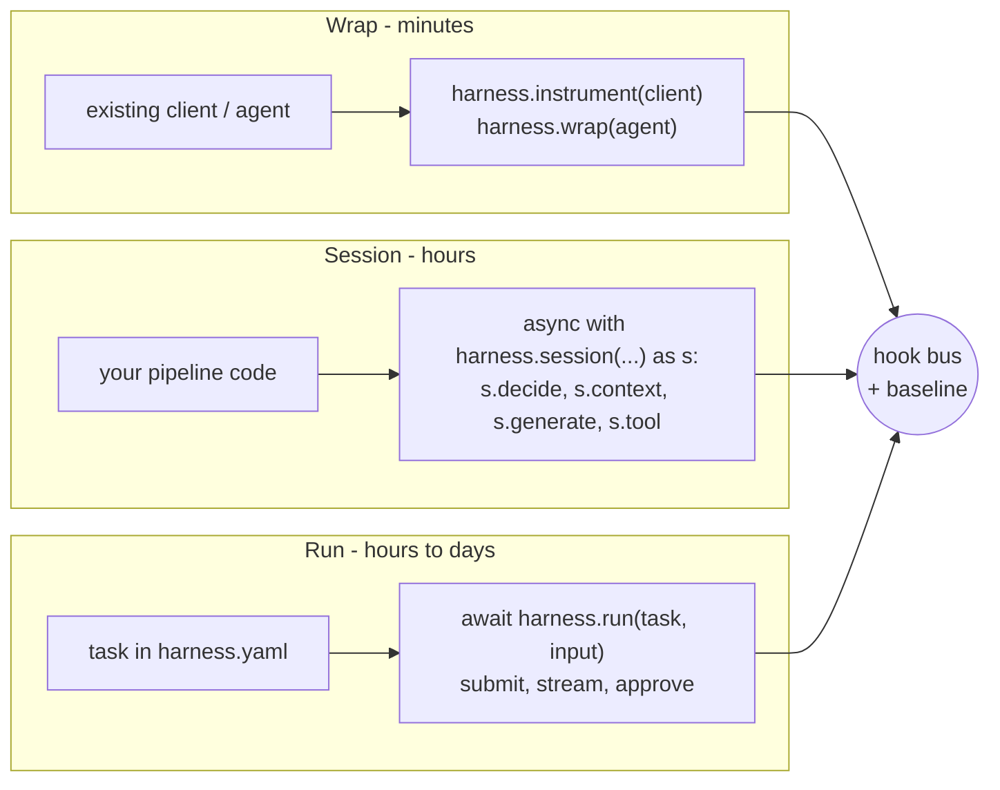

| Style | Effort | Control-flow owner | Controls guaranteed | Use for |
| --- | --- | --- | --- | --- |
| Wrap | Minutes | App's existing framework | The hooks the adapter `reaches` (R4) | Existing apps, quick wins |
| Session | Hours | App code | All hooks except run-level durability | Custom pipelines, RAG |
| Run | Hours to days | HarnessWeaver runner | All hooks plus idempotency, durability, approvals, repair | New tasks, agents, long-running work |

**Runners** (all declare `reaches`):

| Runner | What it executes | Notes |
| --- | --- | --- |
| `direct` | One typed `generate`, optionally with a **bounded** governed tool loop (`max_steps`) | No planning, memory or templating (R12, ADR-0011) |
| `session` | An app function `handler(s: Session, input) -> output` | The framework owns the run lifecycle around it |
| `workflow` | A step DAG (`needs:`), parallel steps, and an evaluator-optimizer loop | Deterministic orchestration only |
| `pydantic_ai.agent` (plugin) | A Pydantic AI agent, governed through a capability | Default runner in the `agent` template; never required |

- **`direct`** sends the task's prompt, rendered from the input (ADR-0013), as the system message and the input as the user message, and offers the task's tools. A registered tool the model names that the task doesn't offer blocks the run with code `tool_not_offered`, because the offer is part of the task's control: another task's approvals wouldn't apply. `max_steps` (default 8) caps the model calls of the tool loop; repairs don't count. Reaching it blocks the run with code `max_steps`. With a task `output` model, the answer is parsed and repaired as No. 20 describes.
- **`session`** calls `runner: { use: session, handler: "pkg.mod:fn" }` as `await fn(session, input)`.
- **Every runner's final output passes `output.before`.** The harness fires it on the value `execute` returns, unless the run just accepted exactly that value (`direct`, `s.generate`, `s.validate`), so an output guard holds whichever runner a task uses and a runner can't forget it (R1, R4). Nothing is left to repair the value there, so a `Retry` ends the run as `on_failure` says, and a `Suspend` re-runs the runner after the approval, where an identical output matches the grant.
- **`workflow`** takes `steps` (each an `id`, a `handler` and the steps it `needs`). Steps that are ready together run in parallel. A step with an `evaluator` loops up to `max_rounds`, passing `feedback` and `round` back to the handler, then applies `on_reject` (`escalate`, `block` or `accept`). `output` names the step whose output is the result (default: the last step).
- **Wrap style.** `harness.instrument(client)` loads the plugin whose namespace is the client's top-level package and asks it for an adapter that wraps the type (`openai.AsyncOpenAI`, `anthropic.Anthropic`, ...); `adapter=` names one. The adapter's `reaches` is checked against the baseline and budgets (R4). Outside a run, each call becomes a small run of its own: `run.start`, `input.before` on the message texts, `model.before`, `model.after`, `output.before` on the answer, `run.end`. Inside a run or session it is one governed model call of that run. Redactions are written back into the request the API receives and the answer the app gets. Streaming through an instrumented client is *planned*; until then it raises rather than running ungoverned.
- **Wrapped agents.** `harness.wrap(agent, task=...)` finds an adapter the same way and returns a governed agent (ADR-0037). Each run of it is a run of its own (`run.start`, `input.before` on the prompt, then every model request, tool call and the final output governed, and `run.end`), or part of the run or session it is called in. An adapter sends its framework's own model calls through `RunContext.generate(request, provider=...)` and its own tools through `RunContext.call_tool(call, backend=...)`, so they get the same hooks, governor, budgets and recording as the harness's own; during a replay the recording answers them instead. A call that needs approval escalates, as in a session, since the harness can't resume the app's code.
- **`pydantic_ai.agent`** (`harnessweaver-pydantic-ai`) runs a task with a Pydantic AI agent: `runner: { use: pydantic_ai.agent, agent: "app.agents:billing_agent" }`, with optional `deps` (`"module:function"` called with the session and input) and `model` (`harness`, the default, asks the spec's `models`; `agent` keeps the agent's own model, governed). The task's `prompt` becomes the agent's instructions, its `tools` are offered next to the agent's own, and `max_repairs` bounds the agent's output retries. Every tool the agent calls needs a manifest (S2), and the model is told the manifest's description and schema, not the agent's, here and in a wrapped agent. A same-named tool still runs the agent's handler: no digest can bind a remote server's behavior, so a toolset's tool names need review or a prefix. A call that needs approval, from the governor, a middleware or a tool marked `requires_approval=True`, suspends the run, and `approve()` resumes the agent with Pydantic AI's deferred tool results.
- **Standalone sessions** (`async with harness.session(...) as s`) offer `generate`, `tool`, `decide`, `context(source).fetch(query)` and `.check(items)`, `guard`, `validate`, `prompt` and `memory`. Their app code can't be resumed later, so `Suspend` escalates there. A halting outcome reaches the app's code as a `RunInterrupted` error (ADR-0020).

## 16. Models

- **Neutral contracts (R7).** `ModelRequest`, `ModelResponse`, `Message`, `ToolSpec`, `ToolCall`, `Usage`. No SDK types cross the port.
- **Gateway first (R5).** `openai.chat` points at LiteLLM Proxy (or any OpenAI-compatible endpoint) with SDK retries off. LiteLLM owns fallbacks, cooldowns, tenant budgets and provider keys (S1).
- **Native Anthropic.** `anthropic.messages` (from `harnessweaver-anthropic`) calls the Messages API, for teams without a gateway and for those who need what Chat Completions doesn't carry: `openai.chat` doesn't request or replay thinking, and has no `effort` or server-side refusal fallbacks.
- **Aliases.** Apps request `fast`, `strong`, `reasoning` or `embed`. Env overlays map aliases to concrete models.
- **Typed output.** `s.generate(output=Schema)` and every runner validate against a Pydantic model, then hand failures to `validation`'s bounded repair.
- **Offline.** The `scripted` provider (also exported as `ScriptedModel` in the test kit) answers from a script or from rule matchers, so every example runs with no network (R14). It ignores settings meant for a real provider, so an offline overlay can switch `models.provider` without repeating the section. With `HARNESSWEAVER_TEST_MODE=1`, live providers refuse to call out.
- **`openai.chat`.** Chat Completions through `openai.AsyncOpenAI`: `base_url` (the gateway), the key from `api_key_env` (S1), retries off by default (R5), the gateway's `x-litellm-response-cost` header used before any price table (ADR-0012), streaming with usage. Output schemas go as `response_format` (non-strict JSON Schema). A message's `refusal`, also under `provider_specific_fields` where LiteLLM moves it, or the finish reason `content_filter` (how LiteLLM reports a Claude refusal) raises `ModelRefusal`. `block_empty_answers` covers a streamed refusal LiteLLM drops, and a `regex.deny` output guard one sent as ordinary text.
- **`anthropic.messages`.** The Messages API through `anthropic.AsyncAnthropic`, with adaptive thinking, optional `effort`, and server-side refusal fallbacks (`fallbacks: default`) on by default. A request the model still declines ends the run `blocked` with code `model_refusal`. Sampling parameters are sent only with `sampling: true`, since current models reject them. Output schemas go in the system prompt unless `structured_outputs: true` (the schema must then meet the API's structured-output rules).
- **Refusals.** A provider raises `ModelRefusal` (a `RunBlocked`, code `model_refusal`) carrying the call's usage and cost but none of its text (R9). The governed call counts them and notes the refusal on the trace (R13), then ends the run before `model.after`. `hold_stream` on either provider delivers chunks only once an answer has finished, as the signal can follow text already streamed. TypeScript matches: `wrapModel` treats the finish reason `content-filter` the same way, with the options `holdStream` and `blockEmptyAnswers`.
- **Provider extensions (ADR-0022).** A model's own per-turn data, such as Claude's thinking blocks, travels in `ModelResponse.extensions` and is copied onto the assistant message the runner adds, so the provider replays it unchanged on the next request. When the harness changed that answer (a redaction), the provider rebuilds the turn without it, and does so on every later request, so the history stays append-only.

## 17. Tool governance

No tool runs without a manifest (S2). The manifest is the contract between the tool's owner, the security team and the governor. `tools.manifests` names the files (globs relative to `harness.yaml`); every manifest is checked when the harness loads (R4).

```yaml
apiVersion: harnessweaver/v1
kind: Tool
metadata: { name: refund_payment, version: 2.1.0, owner: payments-team }
spec:
  transport: native                     # native | http | code | mcp (planned)
  handler: "app.tools:refund_payment"   # native: sync or async, called with the arguments
  description: Refund part or all of a payment.
  input_schema: { $ref: schemas/refund_args.json }   # or inline; the subset in ADR-0026
  definition_digest: "sha256:9f3c..."   # pins {name, description, input_schema}
  side_effect: write_external           # none | read | write_internal | write_external | destructive
  risk: high                            # low | medium | high | critical
  data_access: ["pii:customer"]
  egress: [payments.internal]
  scopes: ["payments:refund"]
  tenants: []                           # enabled for these tenants; empty is all
  rate_limit: { per_principal: 10/m, per_tenant: 200/h }
  approval: { when: "args.amount_usd > 100", approver_role: finance }
  output: { max_bytes: 20000, sanitize: [pii_redact, strip_instructions], label: untrusted }
  timeout: 30s
```

- **Transports.** `native` imports `handler` at load. `http` POSTs the arguments as JSON to `url`, with headers whose values come from the environment variables `headers_env` names (S1); in test mode it refuses to call out (R14). `code` runs the code in one argument (`code_arg`, default `code`) in the `Sandbox` that `sandbox` names, never in the host process (S4, ADR-0027); `sandbox: monty` is short for the plugin's `monty.sandbox`. `mcp` names the MCP `server` that serves the tool; the transport itself is planned, so the harness refuses to load such a tool, while `harnessweaver gateway mcp` already lists it for an MCP gateway.
- **Idempotency.** Every call gets a key that stays the same when a resumed run repeats it, `<run_id>:<call digest>`. A native handler that takes an `idempotency_key` argument receives it, and an http tool gets an `Idempotency-Key` header, so the tool's owner can drop the repeat.
- **Digests.** `definition_digest` is `sha256:` and the hex SHA-256 of the canonical JSON of `{name, description, input_schema}`: keys sorted, no spaces, non-ASCII escaped, integral numbers written as integers (fixtures suite `governor`). A manifest whose pin doesn't match its definition still loads, and every call to it is blocked (rug-pull defense); `harnessweaver doctor` fails it, and warns about manifests with no pin, printing the digest to pin.
- **Tools given in code** carry a manifest too: `ToolDescription.from_manifest(...)`, which `FakeTool` uses. With `tools.require_manifest: true` (the default), a tool without one is blocked (ADR-0028).

The governor runs nine deterministic steps. Steps 1 to 7 run inside the governed tool call, **after** the `tool.before` middleware and on the arguments it leaves, so no middleware can rewrite arguments past the checks (ADR-0025). Step 9 runs before the `tool.after` middleware. Every decision is a `harness.governor` trace note with its step, code and reason, never the argument values (R9, R13).

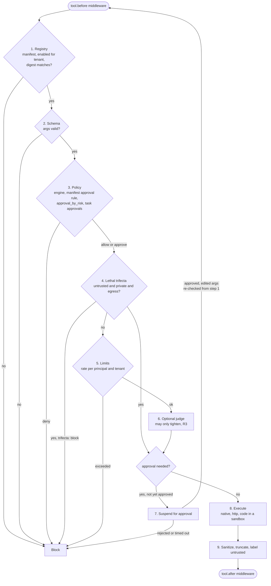

- **Step 3, policy.** The engine `policy.use` names (`cel_lite`, or the plugin's `cel.policy`) decides allow, deny or require approval. Rules combine the same way in every engine (ADR-0025): of the rules whose `when` is true, `deny` beats `require_approval` beats `allow`; among equals the first decides; a `when` that can't be evaluated never loosens a decision; when nothing matches, `policy.default_effect` decides. Approval is also needed when the manifest's `approval.when` is true (or can't be evaluated), when `tools.approval_by_risk` marks the tool's risk `required`, and for the tools a task lists in `approvals.tools`.
- **Step 4, trifecta (S3).** A tool with egress, called after untrusted content and private data both entered the run, needs approval (`tools.trifecta: require_approval`, the default) or is blocked (`block`). Tool output labelled untrusted, retrieved context, a tool with `data_access: [pii:*]`, and a guard finding marked `private` (as `pii.regex`'s are) set the labels.
- **Step 5, limits.** A call reserves its place under each `rate_limit` before the later steps run, so concurrent calls can't all pass the same check, and gives it back if it doesn't go ahead. Windows slide on the injected clock (C4). The run's `max_tool_calls` is checked before `tool.before`.
- **Step 6, judge.** `tools.judge` names a guardrail that sees `{tool, args}`: `block` blocks, `require_approval` or `escalate` asks a human, and a judge that fails asks a human rather than letting the call through or stopping the run alone.
- **Step 7, approval.** A call that needs approval suspends (No. 18), unless the call carries an approval already given. An approval never overrides a deny: edited arguments go through every step again.
- **Step 9, output.** The manifest's sanitizers run (`pii_redact`, then `strip_instructions`) on values and object keys, the result is cut to `max_bytes` of UTF-8 (`tools.max_output_bytes` by default; a JSON result becomes its compact JSON text), and it is labelled untrusted unless `label: trusted`.

**Policy at `run.start`.** A rule with `hook: run.start` decides whether a run or session may start, using `principal`, `tenant`, `task` and `labels` only (checked at load). `deny` blocks the run (`policy_denied`) and `require_approval` escalates it, because a run can't wait before it starts. Only these rules restrict a run: `default_effect` applies to tool calls.

**Dry runs** (ADR-0036). `Harness.authorize(tool, args, principal=, tenant=, task=, labels=)` runs steps 1 to 7 for a call that never executes, with `dry_run=True`: a rate-limit place taken is given back, and nothing is approved. `harnessweaver policy test` checks a table of such calls (`policy_tests.yaml`; schema `policy-tests`) against what each row expects: the `decision` and, when given, its `code`, `step` and `approver_role`. The same manifests generate allow-lists for the MCP gateway and LiteLLM's tool-permission guardrail (`harnessweaver gateway`, No. 24, ADR-0039), so apps that call tools over the network get the same rules.

## 18. Approvals, state and durability

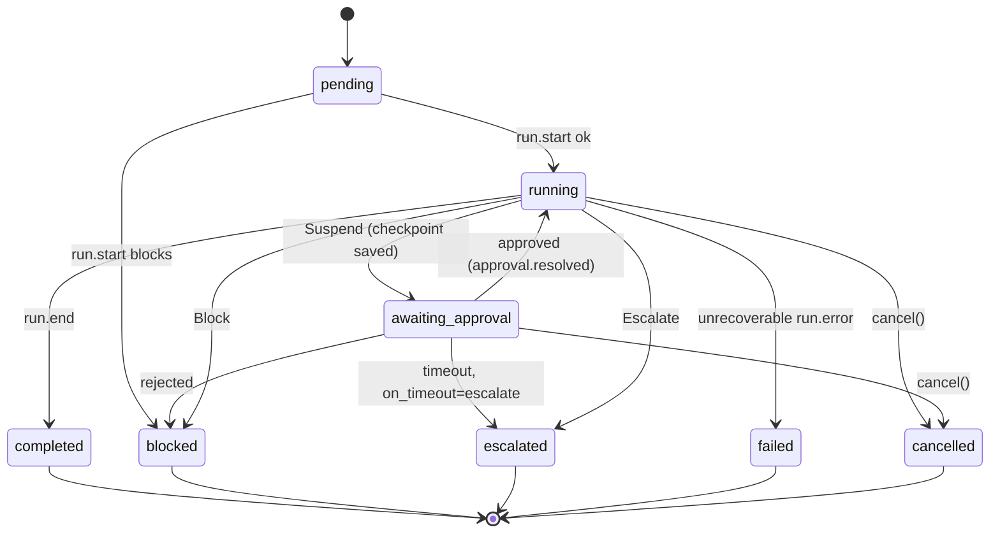

- **Checkpoint** (on Suspend): messages so far, the pending tool call, the budget meter, labels and the step index. Stored in the `StateStore` (`memory` or `sqlite`), so a run resumes after a process restart.
- **`harness.approve(run_id, approval_id, decision, approver, edited_args=None)`**:
  1. Checks the approver holds `approver_role`.
  2. Claims the request in the state store, so one of several concurrent answers wins and the rest get `NotFound` (ADR-0044).
  3. Fires `approval.resolved`.
  4. Re-runs schema and policy on any edited args.
  5. Resumes.
- **Approval requests.** The approver role comes from the step that asked (a middleware's `Suspend`, or the manifest's `approval.approver_role`), then the task's `approvals`, then the spec's `approvals`; the expiry from the task's `approvals`, then the spec's.
- **Channels.** Once the request and checkpoint are saved, the `ApprovalChannel` that `approvals.use` names is notified: `memory` (the default; keeps the requests), `callback` (`handler: "module:function"`, sync or async), `console` (one line on stderr or stdout) `webhook` (`url`; POSTs the `approval-request` contract, with headers from `headers_env`; refuses the network in test mode) or `email` (`host`, `sender`, `recipients`; sends via SMTP with STARTTLS in a worker thread; credentials from environment variables via `login_env` and `password_env`; refuses the network in test mode). A channel that fails is traced (`approval_notify_failed`) and the run keeps waiting, since the request is already saved. A handler must not answer in-line.
- **Grants** (ADR-0045). An approval becomes a grant that matches the call by tool name and arguments, or the output by its content. `approvals.grant_scope` says how long a call's grant lasts: `call` (the default) for one execution, `run` for the rest of the run. A matching call carries the approval into `tool.before` as `event.approval`, so middleware doesn't ask again but still checks edited arguments. Governor step 7 accepts it only if the approver holds the role that step needs (the manifest's, else the task's, else the spec's); otherwise the call asks again, naming that role, and the new answer replaces the old grant, keeping any edit. A matching output carries it into `output.before` the same way, where it answers the guards that ask for approval (No. 20). One approval answers every ask for approval at that step, and nothing else: it never turns a block, an escalation or a repair into an allow.
- **How runs resume** (ADR-0021). `direct` continues from the exact step. `session` and `workflow` run the interrupted handler or step again, so their spent grants stay in the checkpoint for the repeat; finished workflow steps don't run again, and their grants are gone. Work before a suspension point should be safe to repeat. `pydantic_ai.agent` continues the agent from its saved message history with every deferred call answered as approved; the harness's grant lets through the call a human approved and asks again about any other (ADR-0037).
- **Approvals a framework asks for.** `RunContext.approval_needed(call, reason)` turns an approval an adapter's framework asks for into the harness's own: the run suspends at `tool.before` (or escalates where it can't), and the approval is matched to the call by name and arguments like any other.
- **Expiry.** An answer after `expires_at` ends the run as `on_timeout` says (`escalate` or `reject`).
- **Crash safety.** `approve()` saves the answer before resuming. `harness.resume(run_id)` continues a run whose answer was saved but which didn't finish. `harness.cancel(run_id)` stops a live or waiting run.
- **Background runs.** Inside `async with harness:`, `harness.submit(...)` returns a run id at once. `harness.stream(run_id)` yields `RunEvent`s: `status` and `approval` events from the state store's event log, plus live `trace` and streamed `chunk` events.
- **Idempotency.** `harness.run(..., idempotency_key=k)` returns the stored result for `(tenant, task, k)` instead of re-running.
- **Durable runners.** Long-running work delegates to Temporal or DBOS through a `DurableRunner` plugin (planned). HarnessWeaver never builds its own scheduler.
- **Recording and replay** (ADR-0035). With `state.record: true` a run keeps, in order, every model answer (with the digest of the request), tool result (with the call's digest) and human approval it got, as `RecordedCall`s in the state store. `harness.replay(run_id)` runs the task again on a copy of the harness built from the current spec: its model answers from the recording in order, its tools return the recorded result of a matching call and never execute, recorded approvals answer the approvals asked for again, and its runs stay in memory. The `ReplayReport` compares statuses, outputs and the decisions in the two traces (outcomes other than a plain continue, and coded notes), and counts changed requests and calls the recording didn't have. Recordings hold content, so they are off by default and an org can lock them off (R9).

## 19. Routing and decisions

One `Decider` port covers three kinds of decision, with different trust rules.

| Decision kind | Example | Allowed deciders | Trust rule |
| --- | --- | --- | --- |
| Intent / task | Which pipeline answers this question? | rules, lexical, semantic, LLM classifier, AnyJev | May be probabilistic; thresholds tuned on a labelled routing set |
| Model | Which model alias serves this call? | rules by task and size; optional learned router | Returns an alias; the gateway handles fallback |
| Policy | May this principal call this tool with these args? | `cel_lite`, CEL, Cedar, OPA, OpenFGA | Must be deterministic (R3) |

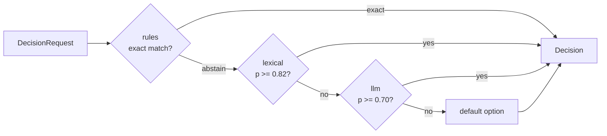

Every stage's answer, confidence and reason is a `harness.routing` trace note, including the stages that lost; the final decision is a `harness.decision` note (R13). Reasons name rules, options and scores, never the request's text (R9).

```yaml
routing:
  support:
    options: [billing, smalltalk, other]
    cascade:
      - { use: rules, file: routes/support.rules.yaml }        # rules: [{ when, choice }]
      - { use: acme.vip_rules }                                 # any @hw.decider
      - { use: lexical, utterances: { billing: [refund my order], smalltalk: [hello there] }, threshold: 0.6 }
      - { use: semantic, file: routes/support.utterances.yaml, threshold: 0.7 }
      - { use: llm, model: fast, threshold: 0.8 }
    default: other
```

- **The cascade (ADR-0029).** Stages run in order and the first confident answer wins. `exact` is confident; `probabilistic` is when its confidence reaches the stage's `threshold` (a stage without one accepts any confidence). An answer outside the router's options, or a stage that fails, counts as an abstention. With no confident stage the router's `default` answers; without a default, `decide` abstains. A stage is labelled by its `id`, or the generated `<use>#<n>`, like guards.
- **One router per middleware.** The cascade answers only requests for its router name, and offers the router's options unless the caller passes its own (`s.decide("support", text=..., options=[...])`). It is installed on `route.decide`, banded by the layer that declared it.
- **`rules`** (deterministic): the first rule whose cel-lite `when` is true over `text`, `state`, `options` and `router` decides exactly; a rule that can't be evaluated doesn't match. Rules come inline or from a `file`.
- **`lexical`** (deterministic): each option scores its closest utterance by the cosine of token counts; the best option wins, with that score as its confidence; ties go to the option listed first; nothing shared abstains. Tokens are lowercased runs of letters and digits.
- **`semantic`**: the same over embeddings. The built-in `Embedder` is `semantic.hashing`: hashed words and character trigrams (32-bit FNV-1a), dependency-free and deterministic; `encoder:` names another `Embedder` provider.
- **`llm`**: asks the model (`model:` alias) to pick an option or none, with a confidence. The call is governed and budgeted, the confidence is uncalibrated (tune the threshold on a labelled routing set), and the model's explanation isn't kept.
- **Custom stages** are `@hw.decider` functions or `Decider` providers from any plugin. `FakeDecider` stands in for routing in tests.

```python
@hw.decider("vip_rules")                      # deterministic custom stage: use: acme.vip_rules
async def vip_rules(req: hw.DecisionRequest) -> hw.Decision:
    if req.state.get("tier") == "vip":
        return hw.Decision.exact("billing_agent", reason="vip customer")
    return hw.Decision.abstain()
```

The tokenizer, the lexical score, the hashing embedder and the cascade are part of the contract (fixtures suite `routing`).

## 20. Guardrails and validation

| Stage | Cheap checks first | Then | Default action |
| --- | --- | --- | --- |
| Input | size, regex, `pii.regex` | `injection.heuristic`, `topic.deny` | redact, block |
| Context | ACL filter, provenance label | injection scan of retrieved chunks | drop chunk |
| Tool result | truncate, `secrets.scan` | PII redaction | redact |
| Output | Pydantic schema, business rules | `grounded.citations`, `llm.judge` | repair once, then escalate or block |

- **Pipeline semantics** (fixtures suite `guards`). Each guard is one middleware on its stage's hook (`input.before`, `context.after`, `tool.after`, `output.before`, `stream.chunk`), so items run in list order (baseline items first), redactions chain and the most severe action wins. Every string in a structured payload is checked, object keys included. A redacted key is written back, and keys that redact to one name stay distinct (`[EMAIL]`, `[EMAIL]#2`) so that no entry is lost. Consecutive `parallel: true` items in one band run concurrently as a group; their redactions are then applied in list order. At the context stage a `block` drops the item, not the run.
- **Actions.** A provider proposes an action; the spec's `action` overrides it whenever the provider flags something. Asking to redact what a provider can't redact blocks. `repair` asks for a repair at the output stage and blocks anywhere else.
- **Approved outputs** (fixtures suite `guards`). An output a human approved reaches `output.before` with `event.approval` (No. 18). A guard's `require_approval` on it is answered: the guard lets it through and adds a `harness.guard` note with code `guard_approved`, its full name and the approver's id (R13). The approval answers nothing else: `block`, `escalate` and `repair` still apply, redactions still chain, and a shadow guard still records what it would do. A rejection is never a grant.
- **Bands.** A guard's band comes from the layer that declared it: org profiles -> `baseline`, built-in profiles -> `platform`, the app -> `app`, a task's own guards -> `task`. Baseline guards must fail closed (R2).
- **Built-in guards.** `regex.deny`, `pii.regex` (e-mail, phone, Luhn-checked card numbers, US SSN, IPv4), `secrets.scan` (private keys, cloud and API keys, tokens, JWTs, credential assignments), `injection.heuristic` (weighted phrases; cheap and easy to evade), `size.limit`, `topic.deny`, `grounded.citations` (output sentences cite the context ids the run kept, ADR-0032) and `llm.judge` (a governed, budgeted model call; its own explanation isn't kept, R9). A finding can be marked `private` (as `pii.regex`'s are), which marks the run private (S3). Their patterns are part of the contract, written in regex syntax Python and TypeScript share.
- **Location transparency.** `where: local | sidecar` picks where a guard's provider runs: in the app, or in harnessd at `sidecar.url` (No. 24, ADR-0038). The guard's place, action, mode and fail mode are the same either way, and app code doesn't change.
- **Shadow mode (R8).** `mode: log_only` records "would have fired" without enforcing. The evals module reports would-fire rates and false positives; promotion to `enforce` is a reviewed one-line change.
- **Firing notes** (ADR-0036). A guard whose verdict isn't `allow` adds a `harness.guard` note to the trace: code `guard_fired`, or `guard_shadow` in shadow mode, with the guard's full name (`guardrails.input[pii]`, `tasks.<task>.guardrails.output[<id>]`), its action and its finding types, never the content (R9). `doctor`, `guard_fired` graders and the shadow-guard report use the same names.
- **Validation.** Pydantic schema validation, then up to `max_repairs` (default 1) repair attempts. Each attempt sends the validation errors back to the model and is traced as a note with code `repair` (field locations and messages only, never the values, R9). Then `on_failure: escalate | block`. Business rules are cel-lite expressions over `output`, `input` and `task` installed as `output.before` middleware: a rule's `when` describes a violation, like a policy rule's `when` (ADR-0023). A true `when`, or one that can't be evaluated, asks for a repair with the rule's `message`.

## 21. Context and memory

```yaml
context:
  kb: { use: memory, file: data/kb.yaml, label: untrusted, max_items: 5, max_tokens: 2000, require_acl: true }
  web: { use: passthrough }          # the app retrieves; the harness governs
memory: { use: memory, default_ttl: 30d }
```

- **Providers.** A `ContextProvider` must itself return only what the envelope's tenant and principal may see. `memory` holds documents (`id`, `content`, `acl`, `metadata`; inline or from a `file`) and searches them lexically, like the `lexical` routing stage; `passthrough` fetches nothing and governs what the app passes to `s.context(name).check(items)`. Vector stores come as plugins (planned).
- **Governance (ADR-0030).** Every item, fetched (`s.context(name).fetch(query)`) or passed in, is governed before the `context.after` middleware sees it: its ACL is re-checked and it is dropped if it excludes the run's tenant or principal, even when its provider returned it (with `require_acl`, items with no ACL are dropped too); its `source` becomes the source's name and it is untrusted unless the source is `label: trusted` (S3); then `max_items` and `max_tokens` (one token per four characters) are enforced in order. Each drop is a `harness.context` note with the item's id, never its content (R9, R13). Then the `context` guard stage and other middleware run, and untrusted items label the run.
- **Kept ids.** The ids of the items a run keeps are remembered, in its checkpoint too, so `grounded.citations` can tell a real source from a made-up one.
- **Memory (ADR-0031).** `s.memory` keeps key-value entries for the run's `(tenant, principal, task)`: `put(key, value, ttl=...)`, `get`, `delete`, `entries`. Entries expire after `ttl` or `memory.default_ttl`, on the run's clock. The harness picks the namespace, so nobody reads another tenant's or principal's entries. It is a store, not a memory model (R12): what an agent remembers, and when, is the app's or its framework's business.

## 22. Observability

- **Spans** follow the OpenTelemetry GenAI conventions, pinned in one constant (`SEMCONV_VERSION = "1.42.0"`): in semantic-conventions 1.42.0 they moved to the separate `semantic-conventions-genai` repository, which has no tagged release yet and keeps them in Development. A test compares the names with the installed `opentelemetry-semantic-conventions` package. Spans: `chat {model}`, `execute_tool {tool}` (and, with agent adapters, `invoke_agent {agent}`, `invoke_workflow {name}`). The framework adds its own spans: `harness.run`, `harness.decision`, `harness.guard`, `harness.approval`. Middleware outcomes other than `Continue`, and failures, are added to the current span as `harness.outcome` events.
- **Attributes** use the GenAI namespace (`gen_ai.operation.name`, `gen_ai.provider.name`, `gen_ai.request.model`, `gen_ai.response.model`, `gen_ai.usage.input_tokens`, `gen_ai.usage.output_tokens`, `gen_ai.tool.name`) plus `harness.*` (`harness.run.id`, `harness.task`, `harness.tenant`, `harness.hook`, `harness.outcome`, `harness.band`, `harness.cost.usd`, `harness.decision.*`, `harness.guard.*`).
- **Metrics:** `gen_ai.client.token.usage`, `gen_ai.client.operation.duration`, and `harness.cost` (USD, for calls whose cost is known).
- **Content.** `capture_content: false` by default (R9). It is usually locked by the org baseline. When on, `gen_ai.input.messages`, `gen_ai.output.messages`, `gen_ai.tool.call.arguments` and `gen_ai.tool.call.result` hold the content after `model.before`, `model.after`, `tool.before` and `tool.after` middleware, so redactions apply.
- **Errors.** Spans record an error's type (`error.type`), never its message (R9).
- **One owner (R5).** The core uses only the OTel *API*. The `otel.sdk` provider from `harnessweaver-otel` configures the SDK and the `exporter` (`console` or `otlp` at `endpoint`) only when `observability.configure_sdk: true`, and leaves an app's own SDK setup alone, so apps that already configure OTel aren't double-configured. An `exporter` without `configure_sdk` is a load error.
- **RunTrace.** A framework-neutral, in-memory record of every hook outcome is always kept on the `RunResult`. It powers `assert_trace` in tests, eval graders (`guard_fired`) and the decision comparison of `harnessweaver replay` (ADR-0035).
- **Logs** go through loguru and are off until the app turns them on: `logger.enable("harnessweaver")`, plus `"harnessweaver_<plugin>"` for a plugin's own logs (ADR-0024). The harness never adds a sink, so where logs go is the app's choice; an app on the standard `logging` module adds a loguru sink that forwards each record. Logs carry ids and error types, never content (R9); the conformance suite checks loguru and `logging` output alike.

## 23. Evals

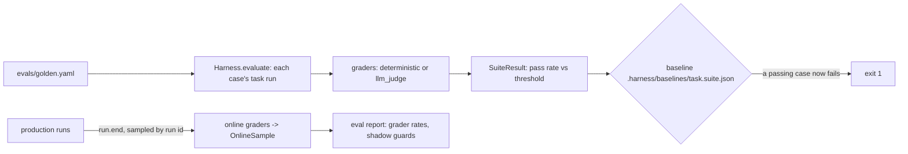

- **One dataset format** (ADR-0033; schema `eval-dataset`) serves CI and production: `suite`, `task`, `graders` (every case gets them), `thresholds.pass_rate` (default 1.0) and `cases`, each with an `id`, `input`, `expect`, its own extra `graders`, `principal` and `tenant`. A grader is written as its name or as `{name: settings}`; a single setting fills the field the grader's config names in `SHORTHAND` (`{field_equals: total}`). Each grader in a case is labelled `name`, `name:value` (a text, number or boolean setting) or `name#n` (a list or map; `n` counts that grader's uses in the case's list from 1), and a label can't repeat.
- **Graders are `Evaluator` providers**, so plugins can add more. The deterministic ones score 1 or 0 (fixtures suite `evals`): `exact` (JSON equality: numbers by value, never a boolean as a number), `field_equals` and `numeric_close` (a dotted path such as `line_items.1.amount`, compared with the same path in `expect`; `tolerance` defaults to 1e-6), `contains`, `regex` and `citation_present` (the output's text: a string as it is, anything else as canonical JSON with sorted keys, no spaces, non-ASCII kept and integral numbers without a fraction), `schema_valid` (the run completed and its output matches the task's output schema, ADR-0026), `guard_fired` (a guard fired or would have, by id or full name; `fired: false` for cases that must stay quiet) and `status` (the run ended with one of the listed statuses, for red-team sets). `llm_judge` asks a model for a 0 to 1 score against a `rubric` and passes at `threshold`; it grades inside a session, so its calls are governed and budgeted, and its own reason isn't kept (R9). Grader reasons name fields, texts by position and rules, never content. A grader that raises fails its case, not the suite.
- **`Harness.evaluate(dataset)`** runs every case's task in order and returns a `SuiteResult`: each case's grades and guard firings, the pass rate (to 6 decimals; the threshold is compared before rounding) and each grader's pass rate.
- **`harnessweaver eval run`** (ADR-0034) runs the spec's suites with their runs kept in memory and compares each with `.harness/baselines/<task>.<suite>.json` (schema `baseline`). A case that passed in the baseline and fails now is a regression. It exits 1 when a suite misses its threshold or regresses and 2 when the suites can't run; `--update-baseline` writes the results of suites that meet their thresholds.
- **Online sampling** at `run.end`. `evals.online.sample_rate` picks a run when FNV-1a 32 of its id, over 2^32, is below the rate, so every process and language agrees. The `evals.online` middleware (platform band, fails open: it is observability, not a control) grades the run with `evals.online.graders`, which must be deterministic (load error otherwise), and keeps an `OnlineSample` (the run id, task, tenant, status, grades and guard firings, but no content) in the state store. `Harness.samples()` and `harnessweaver eval report` read them.
- **Shadow-guard report.** For each `log_only` guard: the runs, how many it would have fired on, the rate, and, in an eval suite, its false positives (cases it would fire on that don't expect it with a `guard_fired` grader) and misses (cases that expect it where it wouldn't fire). `eval run` prints it per suite; `eval report` gives the would-fire rate over production samples.

## 24. Cross-language delivery

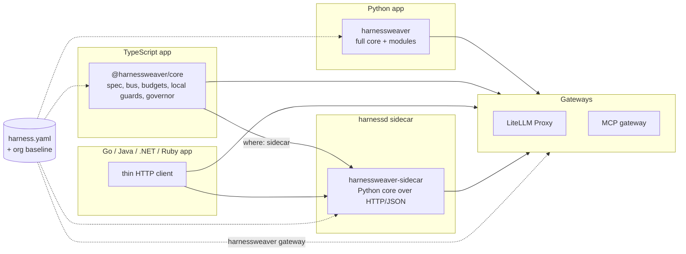

| Delivery mode | Languages | In-process | Elsewhere |
| --- | --- | --- | --- |
| Native SDK, full | Python | Spec loader, hook bus, all modules, all adapters | Gateways only |
| Native SDK, core | TypeScript | Spec loader, hook bus, budgets and cost, built-in guards, cel-lite policy and validation rules, `rules` and `lexical` routing, tool governor, context, prompts, eval graders; sessions only (ADR-0040) | Python-only providers through the sidecar |
| Sidecar client | Go, Java, .NET, Ruby, others | A thin HTTP client | `harnessd` |
| Gateway only | Anything that speaks HTTP | Nothing | LiteLLM Proxy and the MCP gateway, configured from the same spec |

**Contracts are the source of truth (R11):**
- JSON Schema 2020-12 for the spec, profiles, tool manifests and every event payload.
- OpenAPI for the sidecar's HTTP/JSON API. A protobuf definition mirrors it for future gRPC serving.
- The OTel GenAI conventions plus `harness.*` attributes.
- Language-neutral **conformance fixtures** that every implementation must pass.

### The TypeScript SDK

`@harnessweaver/core` loads the same `harness.yaml` and passes the same fixtures as Python (ADR-0040). It runs the Session style: the app owns the flow, and its model calls are the AI SDK's, governed through `@harnessweaver/ai-sdk`.

```ts
const harness = load("harness.yaml");
const reply = await harness.session({ task: "support", principal: user.id, tenant: user.org }, async (s) => {
  const items = await s.context("kb").fetch(question);
  const { text } = await generateText({ model: wrapModel(s, openai("gpt-5")), prompt: ask(question, items) });
  return s.validate("output", text);
});
```

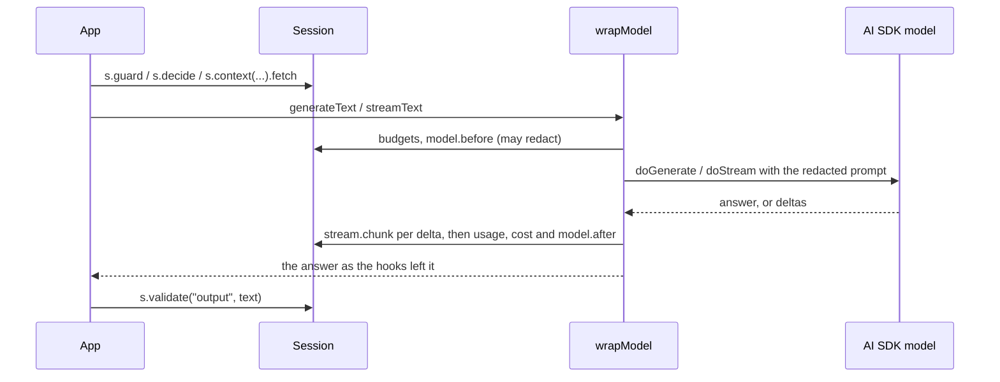

- **What runs natively:** the spec system (layers, locks, bounds, built-in and org profiles, levels), the hook bus, budgets and cost, the built-in guards, cel-lite policy and validation rules, the `rules` and `lexical` routing stages, the tool governor (steps 1 to 7, and step 9 on results) for tools whose handlers the app passes to `load({ tools })`, the `memory` and `passthrough` context providers, versioned prompts and the eval graders.
- **What it refuses:** anything the spec asks TypeScript to enforce that it can't fails loading (R4), such as a guard or stage with no TypeScript provider, unless the guard is declared `where: sidecar`.
- **What differs:** a `Suspend` escalates, because a TypeScript session can't wait for a person; a Retry at `model.after` re-asks a generate call once and blocks a stream, whose words were already sent.
- *Planned:* OpenTelemetry export, the `semantic` and `llm` routing stages, `http` and `mcp` tool transports, and durable approvals.

Example 04 runs Example 02's spec this way, and its tests require the same answers from the TypeScript app and from harnessd serving that spec.

### harnessd

`harnessd` (the `harnessweaver-sidecar` package) serves one effective spec over HTTP/JSON (ADR-0038). It loads the spec as an app does (layers, locks, plugins, tasks), so a client in any language gets exactly the decisions the Python core makes.

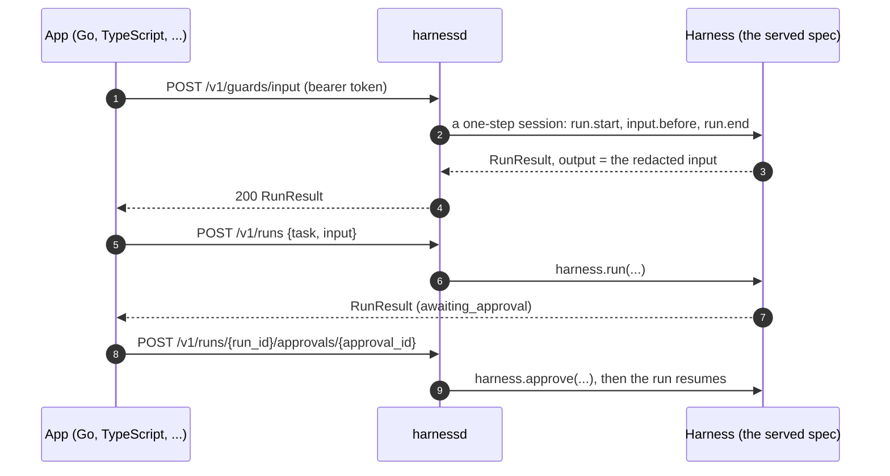

| Route | What it does | Answer |
| --- | --- | --- |
| `GET /v1/health` | Liveness and versions; the only route without a token | `{status, harnessd, harnessweaver}` |
| `GET /v1/spec`, `GET /v1/hooks?task=` | The effective spec; the middleware on each hook point, in run order | `SpecInfo`; lists of `HookEntry` |
| `POST /v1/guards/{stage}` | `input`, `context` or `output`: that stage's hook, as `s.guard`, `s.context(...).check` and `s.validate` run it | `RunResult` |
| `POST /v1/guards/providers/{name}:check` | One guardrail provider, for a guard declared `where: sidecar` | `GuardResult` |
| `POST /v1/decisions/{router}` | A routing decision (`route.decide`) | `RunResult`, output a `Decision` |
| `POST /v1/policy/evaluate` | The policy engine alone | `PolicyDecision` |
| `POST /v1/tools/{name}/authorize` | The governor's steps 1 to 7, as a dry run (ADR-0036) | `ToolVerdict` |
| `POST /v1/tools/{name}/sanitize` | Step 9, then `tool.after`, on a result the caller's own tool returned | `RunResult`, output a `ToolResult` |
| `POST /v1/validate` | A final output parsed into its task's output type, then `output.before` | `RunResult` |
| `POST /v1/runs`, `GET /v1/runs/{run_id}`, `POST /v1/runs/{run_id}/approvals/{approval_id}` | Run a task, read a run, answer an approval | `RunResult` |
| `POST /v1/evals/run` | An eval suite sent in the request, or a file the spec's `evals` lists | `SuiteResult` |

- **Checks are one-step sessions.** A check opens a session for the principal, tenant and task the request names, makes its one governed call and closes it, so `run.start` rules, budgets, the trace and the stored run all apply. A block or a failed check is the `RunResult`'s `status` and `error`, not an HTTP error, and `GET /v1/runs/{run_id}` reads it later. The caller names the principal: holding the token makes it the app, which already decides who it acts for.
- **Errors.** A taxonomy error that reaches a route answers with its `ErrorInfo`: 400 for `spec_invalid` and `expression_error`, 403 `policy_denied`, 404 `not_found`, 422 `validation_failed`, 502 for provider and tool errors. An invalid request is described by field locations and messages, never by the values it held (R9).
- **Security (S6).** harnessd binds 127.0.0.1 unless told otherwise, refuses to start without a token (`HARNESSD_TOKEN`, or the variable `--token-env` names) and compares tokens in constant time. The token is checked in ASGI middleware before any of the body is read, because FastAPI reads and parses a body before it solves a route's dependencies; bodies from token holders are capped by `--max-body-bytes` (413).
- **`where: sidecar`.** A guard declared so keeps its place on the bus, its action, mode, fail mode and timeout; only its provider's check is posted to `{sidecar.url}/v1/guards/providers/{name}:check`, with the token from `sidecar.token_env`. The provider needn't be installed next to the app; `plugins.allow` applies to its name on both sides (S8). The request uses the standard library in a worker thread (ADR-0003) and is refused in test mode (R14); a sidecar that can't answer is a provider error, which the guard's fail mode turns into a block or a pass (R2).
- **Contracts.** `contracts/openapi/harnessd.openapi.json` is generated from the routes and the request models in `harnessweaver.core.sidecar` (`make schemas`) and drift-tested. `contracts/proto/harnessweaver/v1/harnessd.proto` mirrors every route in its `google.api.http` options, and a test keeps the two in step; gRPC is served later (ADR-0007).
- **Image.** `deploy/harnessd/Dockerfile` builds from `uv.lock` on digest-pinned bases (S5) and runs as an unprivileged user. Inside the container harnessd listens on all of the container's interfaces; publish the port on the host's 127.0.0.1.
- *Planned:* the `stream` guard stage, gRPC, and an approval page.

### Gateways

An app that calls models and tools straight through a gateway, with no SDK, still gets controls from the same spec (ADR-0039). `harnessweaver gateway litellm` writes a LiteLLM Proxy config, and `harnessweaver gateway mcp` a neutral tool allow-list (schema `tool-allow-list`) for an MCP gateway. Examples 02 and 03 keep both under `gateway/`, tested as golden files.

| From the spec | To the gateway |
| --- | --- |
| `models.aliases`, `models.default`, `allowed_aliases` | LiteLLM `model_list` (one entry per gateway model, its provider model from `HARNESSWEAVER_UPSTREAM_<NAME>`) and `router_settings.model_group_alias` |
| R5: the gateway owns retries | `router_settings.num_retries: 2` |
| The longest run deadline | `router_settings.timeout`, so the gateway gives up when the harness does |
| `observability.capture_content: false` (R9); `exporter: otlp` | `litellm_settings.turn_off_message_logging`; the `otel` callback and its endpoint |
| Tool manifests | A `tool_permission` guardrail on every request: allow the allow-list's tools (with their arguments' `pattern` or `enum` as regexes), deny the rest; and the allow-list with each tool's digest and scopes |
| S1 | `master_key: os.environ/LITELLM_MASTER_KEY`; provider keys stay in the gateway's environment |

A gateway can't see a run, so a tool is let through only when its manifest asks for nothing that needs one. A tool that can need approval (its `approval`, `tools.approval_by_risk`, a task's `approvals.tools`), has egress (the trifecta check, S3), is enabled for some tenants only, has rate limits, is disabled, or whose pin doesn't match its definition (S2) is **withheld**: denied at the gateway and listed with the reason, to run through the harness or harnessd. Policy rules, budgets and guards stay with the harness.

`harnessweaver dev` writes `.harness/dev/` next to the spec: that LiteLLM config, an OpenTelemetry collector that sends traces to Langfuse over OTLP HTTP, a Compose file with LiteLLM, the collector, Langfuse (web, worker, Postgres, ClickHouse, Redis, MinIO) and harnessd, and a `.env` of generated local secrets, written once and kept. harnessd and the collector share LiteLLM's network, so a spec's `localhost` URLs work inside the containers too. Images are pinned by digest (S5), ports are published on 127.0.0.1 only (S6), and `--up` runs `docker compose up -d`.

## 25. Packaging and dependency graph

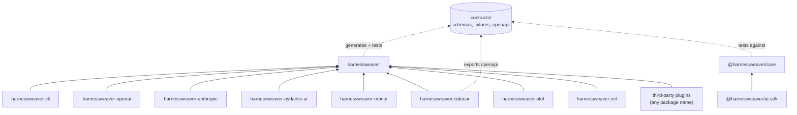

The repository is a **uv workspace** (Python) plus a **pnpm workspace** (TypeScript, rooted in `typescript/`, which also holds Example 04), sharing one `contracts/` directory. The docs site is built from `docs/` and `mkdocs.yml`, with its tools in the uv workspace's `docs` dependency group (ADR-0041); the code its tutorial shows lives in `docs_src/`, run by the tests (ADR-0042). The core declares extras that pull in first-party plugins (`harnessweaver[openai]`, `harnessweaver[all]`). Plugins built outside this repository need nothing from it except the public extension surface (No. 13).

```
python/harnessweaver/                 python/plugins/<name>/   (harnessweaver-<name>)
python/harnessweaver-cli/             typescript/packages/core/
python/harnessweaver-sidecar/         typescript/packages/ai-sdk/
contracts/  deploy/  examples/  docs/
```

## 26. Versioning and compatibility

| Versioned thing | Scheme | Breaking change means | Support window |
| --- | --- | --- | --- |
| Contracts (`harnessweaver/v1`) | Major in the `apiVersion` string; minor additions only | Removing or changing a field, hook point or action | Previous major supported 12 months after the next ships |
| Packages (core, CLI, sidecar, plugins, TS) | SemVer per package | Public Python or TS API change | Latest two minors patched |
| Profiles (built-in and org) | SemVer; specs pin a range such as `@^2` | Adding a lock or tightening a bound | Org decides; `spec diff` shows impact |

Providers and adapters declare the contract range they support (`contract=">=1.0,<2"`), and the loader refuses incompatible combinations (V5).

Each package is released on its own, from a Git tag `<package>@<version>` (`harnessweaver@0.2.0`, `@harnessweaver/core@0.2.0`) whose SemVer version must equal the one in the package's manifest. `make release` (`scripts/release.py`) builds and publishes the packages tagged on HEAD, or only those named in `PACKAGE`, to PyPI and npm.

## 27. Security model

| Threat | Controls |
| --- | --- |
| Prompt injection through retrieved content or tool output | `untrusted` labels, `injection.heuristic` on input and context, lethal-trifecta check, approvals for egress |
| Tool definition swapped after review ("rug pull") | `definition_digest` pinning, checked at governor step 1 |
| Data exfiltration | `egress` allow-lists in manifests, trifecta check, approval for `write_external`, gateway allow-lists |
| PII leakage to logs or vendors | `pii.regex` / Presidio redaction, `capture_content: false` locked by baseline, R9 conformance check |
| Privilege escalation through an LLM decision | Deterministic policy only (R3); judges may only tighten |
| Cost runaway / denial of wallet | Per-run budgets and deadlines; tenant budgets at the gateway; tool-call caps |
| Malicious generated code | `sandbox: monty`; no `eval`/`exec` in the host (S4) |
| Supply-chain compromise | Locked dependencies, SHA-pinned CI actions, digest-pinned images, SBOM, signed releases (S5) |
| Sidecar exposure | Binds `127.0.0.1` by default, bearer token on every route except health (S6) |
| Apps switching controls off | Locks and bounds enforced at load (R1, R10); `require_level` by risk tier |

## 28. Architecture decision records

Each ADR records a decision, the reason for it, and its status, in its own file under [`docs/adr/`](docs/adr/), which the docs site leaves out (ADR-0047). This table indexes them. A new decision adds a file and a row here; a changed decision adds a new ADR that supersedes the old one, whose status then says so.

| ADR | Decision | Status |
| --- | --- | --- |
| [0001](docs/adr/0001-ship-as-harnessweaver.md) | Ship as HarnessWeaver | Accepted |
| [0002](docs/adr/0002-python-312.md) | Support Python 3.12 and later | Accepted |
| [0003](docs/adr/0003-core-dependencies.md) | The core's dependencies | Accepted |
| [0004](docs/adr/0004-cel-lite.md) | cel-lite, the built-in expression language | Accepted |
| [0005](docs/adr/0005-contracts-from-pydantic.md) | Contracts are Pydantic models; schemas are generated | Accepted |
| [0006](docs/adr/0006-workspace-packages.md) | One uv workspace of separate packages | Accepted |
| [0007](docs/adr/0007-sidecar-http-first.md) | The sidecar speaks HTTP/JSON first | Accepted |
| [0008](docs/adr/0008-guard-modes.md) | Spec guards enforce by default; the CLI scaffolds shadow guards | Accepted |
| [0009](docs/adr/0009-durability-checkpoints.md) | Durability starts as state-store checkpoints | Accepted |
| [0010](docs/adr/0010-otel-api-only.md) | The core uses only the OpenTelemetry API | Accepted |
| [0011](docs/adr/0011-bounded-tool-loop.md) | The direct runner's bounded tool loop | Accepted |
| [0012](docs/adr/0012-no-price-table.md) | No built-in price table | Accepted |
| [0013](docs/adr/0013-prompts-without-templates.md) | Versioned prompts without a template language | Accepted |
| [0014](docs/adr/0014-required-fail-mode.md) | A middleware's fail_mode is required | Accepted |
| [0015](docs/adr/0015-plugins-by-design.md) | Plugins are defined by design, not by name | Accepted |
| [0016](docs/adr/0016-non-core-dependencies.md) | Dependencies outside the core | Accepted |
| [0017](docs/adr/0017-yaml-1-2.md) | Specs are YAML 1.2 (core schema) | Accepted |
| [0018](docs/adr/0018-locks-and-bounds.md) | Locks forbid changes, not restatements; bounds accumulate | Accepted |
| [0019](docs/adr/0019-one-models-section.md) | One models section | Accepted |
| [0020](docs/adr/0020-halting-errors.md) | Halting outcomes raise RunInterrupted errors | Accepted |
| [0021](docs/adr/0021-resuming-approved-steps.md) | How approved steps resume | Accepted |
| [0022](docs/adr/0022-provider-extensions.md) | Provider extensions on messages and responses | Accepted |
| [0023](docs/adr/0023-validation-rule-when.md) | A validation rule's when describes a violation | Accepted |
| [0024](docs/adr/0024-loguru.md) | Logging through loguru | Accepted |
| [0025](docs/adr/0025-governor-placement.md) | Where the governor runs, and one way to combine policy rules | Accepted |
| [0026](docs/adr/0026-json-schema-subset.md) | A JSON Schema subset validator in the core | Accepted |
| [0027](docs/adr/0027-code-transport.md) | Code-executing tools use transport: code | Accepted |
| [0028](docs/adr/0028-manifests-for-code-tools.md) | Tools given in code carry manifests; stale pins block calls | Accepted |
| [0029](docs/adr/0029-routing-cascade.md) | Routing cascades and shared text scoring | Accepted |
| [0030](docs/adr/0030-context-governance.md) | Context governance runs before context.after | Accepted |
| [0031](docs/adr/0031-namespaced-memory.md) | A namespaced memory store, not a memory model | Accepted |
| [0032](docs/adr/0032-grounded-citations.md) | The grounded.citations guard | Accepted |
| [0033](docs/adr/0033-eval-datasets.md) | Eval datasets and graders | Accepted |
| [0034](docs/adr/0034-baselines-and-online-evals.md) | Eval baselines, exit codes and online sampling | Accepted |
| [0035](docs/adr/0035-record-and-replay.md) | Recording and replaying runs | Accepted |
| [0036](docs/adr/0036-dry-runs-and-guard-notes.md) | Governor dry runs and guard firing notes | Accepted |
| [0037](docs/adr/0037-framework-adapters.md) | One adapter object per agent framework | Accepted |
| [0038](docs/adr/0038-harnessd.md) | harnessd serves one spec over /v1 | Accepted |
| [0039](docs/adr/0039-gateways-and-dev-stack.md) | Gateway configs and the local dev stack | Accepted |
| [0040](docs/adr/0040-typescript-sdk.md) | The TypeScript SDK | Accepted |
| [0041](docs/adr/0041-docs-site.md) | The docs site: MkDocs and Material | Accepted |
| [0042](docs/adr/0042-docs-structure.md) | The docs' structure, with tested tutorial code | Accepted; amended by 0047 |
| [0043](docs/adr/0043-profile-ownership.md) | Profiles an app's team can write merge after the platform's | Accepted |
| [0044](docs/adr/0044-answers-claim-the-approval.md) | An answer claims the approval before it resumes the run | Accepted |
| [0045](docs/adr/0045-what-an-approval-covers.md) | What an approval covers: one execution, by the role that step needs | Accepted |
| [0046](docs/adr/0046-landing-page.md) | The website: a landing page at the root, the docs under /docs/ | Accepted; amended by 0047 |
| [0047](docs/adr/0047-docs-for-users.md) | The docs site leaves out the ADRs and outside inspirations | Accepted |

## 29. Deviations from the design guide

| Guide says | HarnessWeaver does | Why (ADR) |
| --- | --- | --- |
| Working name `harnesskit`, CLI `harness` | `harnessweaver`, CLI `harnessweaver` | Name taken; brand decision (0001) |
| Python 3.11+ | Python 3.12+ | User decision (0002) |
| Core depends only on Pydantic and the OTel API | Adds PyYAML, anyio and loguru | The spec format and deadlines need the first two (0003); logging uses loguru (0024) |
| `cel-python` in the core | Built-in cel-lite; full CEL as a plugin | Dependency weight (0004) |
| JSON Schema is the source, Pydantic generated from it | Pydantic generates JSON Schema, which is drift-tested | Single authoring path (0005) |
| Monorepo of independent packages under `python/`, `typescript/` | Same idea: uv + pnpm workspaces, with plugins as separate packages | - (0006) |
| Providers registered through a `harnesskit.providers` entry-point group; `plugins: [module]` for in-repo code | One `harnessweaver.plugins` entry-point group exposing an `hw.Plugin` object per distribution; `plugins: { local, allow }` in the spec; namespaced names | One contract for every contribution kind, lazy loading, org allow-lists (0015) |
| Sidecar with FastAPI + gRPC | HTTP/JSON first, proto kept for later gRPC | Scope (0007) |
| `harness.yaml` guards enforce as written | Same, plus the CLI scaffolds shadow guards | (0008) |
| A versioned price table in core | No built-in prices | Accuracy (0012) |
| `model_access` (org) plus `models` (app) | One `models` section with `provider`, `aliases`, `allowed_aliases` | One place to read model access (0019) |
| YAML parsed by whatever library a language has | YAML 1.2 core schema everywhere; duplicate keys fail | Same meaning in every language (0017) |
| Code tools are `sandbox: monty` on a native tool | `transport: code` with a named `sandbox` | The host never runs the code, and a code tool without a sandbox fails to load (0027) |
| `approvals: { channel: ... }` | `approvals: { use: ... }`, like every other provider-selecting section | One spelling for choosing a provider |
| Governor runs on `tool.before` | Inside the governed call, after the `tool.before` middleware, on the final arguments | Middleware can't rewrite arguments past the checks (0025) |
| `semantic` stage with a local model encoder (`local/bge-small`) | `semantic` uses the built-in hashing embedder unless `encoder:` names an `Embedder` provider | No model dependency in the core; real encoders come as plugins (0029) |
| The Pydantic AI adapter installs the framework's middleware as Pydantic AI capabilities and hooks; `runner: { use: pydantic_ai, agent: ... }` | One `HarnessCapability` sends each model request and tool call through the hook bus; `runner: { use: pydantic_ai.agent, agent: ... }` | One place for budgets, telemetry and the governor; runner names are `namespace.name` (0037, 0015) |

## 30. Open decisions

| Decision | Options | Current leaning |
| --- | --- | --- |
| Reserve package names | PyPI: `harnessweaver`, `harnessweaver-cli`, `harnessweaver-sidecar`; npm org `@harnessweaver` | Reserve before any public announcement |
| Hosted control plane | Build later; never | Defer. Spec plus Git is the control plane until more than 20 apps adopt |
| Default observability backend for `harnessweaver dev` | Langfuse; Phoenix | Langfuse locally, OTLP only in the core |
| gRPC sidecar | Alongside HTTP; after HTTP | After the HTTP API has stabilised |
| Durable runner | Temporal; DBOS | Pick based on the pilot teams' existing infrastructure |
