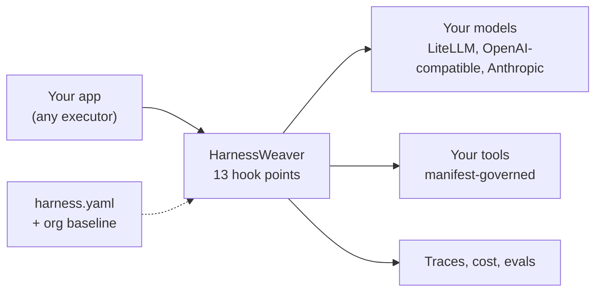

<div align="center">


[](https://github.com/Wise-DreamerZ/HarnessWeaver/actions/workflows/ci.yml?query=branch%3Amain)
[](https://github.com/Wise-DreamerZ/HarnessWeaver/actions/workflows/ci.yml?query=branch%3Amain)
[](https://pypi.org/project/harnessweaver/)
[](https://pypi.org/project/harnessweaver/)
[](https://www.npmjs.com/package/@harnessweaver/core)
[](https://www.npmjs.com/package/@harnessweaver/core)
[](LICENSE)
[](https://harnessweaver.wisedreamerz.com/docs/)

<a href="https://www.producthunt.com/products/harnessweaver?embed=true&amp;utm_source=badge-featured&amp;utm_medium=badge&amp;utm_campaign=badge-harnessweaver" target="_blank" rel="noopener noreferrer"><picture><source media="(prefers-color-scheme: dark)" srcset="https://api.producthunt.com/widgets/embed-image/v1/featured.svg?post_id=1313224&amp;theme=neutral&amp;t=1794456004865"></picture></a>

</div>

---

## What is HarnessWeaver?

Every AI application needs the same cross-cutting controls around its models: tracing and cost, budgets and deadlines, PII redaction and injection checks, validated output, governed tool calls, human approvals, routing and evals. Most teams rebuild these controls inside each app, differently every time.

HarnessWeaver is a **framework for building your own harness**. You keep the executor you already use (raw SDK calls, Pydantic AI, the Vercel AI SDK, a custom pipeline), describe your controls in one `harness.yaml`, and HarnessWeaver intercepts every model call, tool call and output at 13 fixed hook points. Your platform team publishes an org baseline that every app inherits and no app can remove.



## What you get

| Control | How |
| --- | --- |
| Tracing and cost | Every run, model call, tool call and decision traced (OpenTelemetry GenAI conventions) and costed |
| Budgets and deadlines | Per-run limits on cost, tokens, model calls, tool calls and time, checked before each call |
| Guardrails | PII, secrets, prompt injection, size, topics, citations and LLM judges on input, retrieved context, tool results, output and streams; new guards start in shadow mode |
| Typed output | Pydantic validation with bounded repair, plus cel-lite business rules |
| Tool governance | No tool runs without a manifest; a nine-step governor checks schema, policy, the lethal trifecta, rate limits and approvals |
| Policy and approvals | Deterministic rules decide; a human approves what they require; runs suspend durably and resume |
| Routing and retrieval | Routing cascades (rules, lexical, semantic, LLM); ACLs re-checked on every retrieved item |
| Evals | Golden and red-team sets with baselines in CI, shadow-guard reports, online sampling |
| An org baseline | Locks, bounds and a required adoption level by risk tier, enforced when an app loads |

## A taste

The spec declares the controls ([Example 01](examples/01_invoice_extraction/README.md), abridged):

```yaml
apiVersion: harnessweaver/v1
kind: Harness
metadata: { name: invoice-extraction, owner: finance-platform, risk_tier: internal }
extends: ["profile://extraction"]          # PII redaction on input, secrets check on output, one repair

models:
  provider: openai.chat                    # LiteLLM Proxy, or any OpenAI-compatible endpoint
  base_url: http://localhost:4000          # the gateway holds the provider keys and owns retries
  api_key_env: LITELLM_API_KEY
  default: fast
  aliases: { fast: fast-chat }
  prices: { fast-chat: { input_per_mtok: 0.25, output_per_mtok: 2.00 } }

tasks:
  extract_invoice:
    runner: direct
    input: invoices.models:InvoiceDoc
    output: invoices.models:Invoice        # a Pydantic model; an invalid answer is repaired
    prompt: extract_invoice@1
    budget: { max_model_calls: 3, max_usd: 0.02, deadline: 30s }

validation:
  rules:
    - { id: positive-total, when: "output.total <= 0", message: "the total must be positive" }
```

and the app's code is one call, with no retry loop, error handling around the model or tracing setup:

```python
import asyncio

import harnessweaver as hw
from invoices.models import Invoice, InvoiceDoc
from invoices.samples import INVOICE_TEXT


async def main() -> None:
    harness = hw.load("harness.yaml")      # profiles, org baseline and env overlay, validated here
    result = await harness.run("extract_invoice", InvoiceDoc(text=INVOICE_TEXT), principal="ap-clerk", tenant="acme")
    if result.ok:
        invoice = Invoice.model_validate(result.output)
        print(invoice.invoice_number, invoice.total, invoice.currency)
    print(result.status, result.cost_usd)  # every hook, guard and repair is on result.trace


asyncio.run(main())
```

Already have an app? Govern the client it uses, without changing the code that calls it:

```python
client = harness.instrument(AsyncOpenAI(base_url="http://localhost:4000"), tenant="acme")
reply = await client.chat.completions.create(model="fast-chat", messages=messages)   # traced, costed, budgeted, guarded
```

The same spec also serves [TypeScript](https://harnessweaver.wisedreamerz.com/docs/advanced/typescript/) apps, and any language through the [harnessd sidecar](https://harnessweaver.wisedreamerz.com/docs/advanced/sidecar/).

## A framework for building harnesses

| | A central harness | HarnessWeaver |
| --- | --- | --- |
| Who owns control flow | The harness | Your app, with HarnessWeaver intercepting |
| How controls are applied | Hard-wired in one runtime | Composed per app from plugins, plus an org baseline that can't be removed |
| Adopting it | Route your app through it | One line for tracing, then grow level by level |
| Languages | Usually one | Python, TypeScript, and any language through the sidecar |

## Try it

With [uv](https://docs.astral.sh/uv/getting-started/installation/) installed, and nothing else:

```bash
uvx --from harnessweaver-cli harnessweaver init my-app   # a project; -t rag | agent | workflow | chat for others
cd my-app
uv sync                                                  # its dependencies, from PyPI
HARNESSWEAVER_ENV=offline uv run python -m app.main      # run its task offline: no keys, no spend
uv run harnessweaver test                                # its tests, offline
```

[QUICKSTART.md](QUICKSTART.md) walks from here to a governed, traced and tested task of your own, and then to a real model, in about ten minutes. The examples below run from a clone:

```bash
git clone https://github.com/Wise-DreamerZ/HarnessWeaver.git && cd HarnessWeaver
uv sync --all-packages
HARNESSWEAVER_ENV=offline uv run python examples/01_invoice_extraction/run.py
```

| Example | Shows |
| --- | --- |
| [01 Invoice extraction](examples/01_invoice_extraction/README.md) | L1 in the Run style: typed output with repair, PII redaction, a secrets check, budgets; L0 in three lines |
| [Org baseline](examples/_org/README.md) | The profile a platform team publishes: locks, bounds and a required level per risk tier |
| [02 Support assistant](examples/02_support_rag/README.md) | The Session style for a customer-facing app: routing, ACL-checked context, injection guards, citations, the org baseline's locks |
| [03 Refund agent](examples/03_refund_agent/README.md) | Run and Wrap styles with a Pydantic AI agent: governed tools, policy, the lethal trifecta, approvals, a red-team eval set, an app's own plugin |
| [04 One spec, every language](examples/04_polyglot_typescript/README.md) | Example 02's spec from TypeScript (in process, with the Vercel AI SDK) and through harnessd, with the same answers both ways, plus a `curl` walkthrough for any language |

## Packages

| Package | What it is |
| --- | --- |
| `harnessweaver` | Python core: spec loader, hook bus, envelope and budgets, runners, the built-in modules, test kit |
| `harnessweaver-cli` | Developer tooling: the `harnessweaver` command |
| `harnessweaver-sidecar` | `harnessd`, which serves the core to other languages over HTTP |
| `harnessweaver-openai`, `-anthropic`, `-pydantic-ai`, `-monty`, `-otel`, `-cel` | First-party Python plugins |
| `@harnessweaver/core` | TypeScript core: the same spec, hook bus, guards, governor and routing, in sessions ([typescript/](typescript/README.md)) |
| `@harnessweaver/ai-sdk` | `wrapModel` for Vercel AI SDK models |

**Plugins are defined by design, not by name.** Any package that exposes an `hw.Plugin` through the `harnessweaver.plugins` entry point is a plugin, so you can build one in your own repository, publish it under any name, and use it from `harness.yaml` (`use: acme.pii`). See [Extending HarnessWeaver](https://harnessweaver.wisedreamerz.com/docs/advanced/#extending-harnessweaver).

## Adoption levels

| Level | You add | You get |
| --- | --- | --- |
| **L0 Observe** | `harness.instrument(client)` | OTel GenAI traces, token and cost per tenant and task, error taxonomy |
| **L1 Guard** | `guardrails:` and typed task outputs | PII redaction, injection and secret checks, schema validation with bounded repair |
| **L2 Govern** | tool manifests, `budgets:`, `policy:` | Tool allow-lists, arg validation, risk-based approval, budgets, audit trail |
| **L3 Orchestrate** | `tasks:` with runners, `routing:` | Idempotency, deadlines, durable suspend and resume, routing cascades |
| **L4 Improve** | `evals:` | CI quality gates, shadow-guard reports, online sampling |

## Documentation

The user documentation is at [harnessweaver.wisedreamerz.com/docs](https://harnessweaver.wisedreamerz.com/docs/), built from [`docs/`](docs/index.md) (`make docs` builds it into `site/`, `make docs-serve` serves it locally). Read it there: its pages include their code from tested files, which GitHub doesn't show.

| Doc | For |
| --- | --- |
| [QUICKSTART.md](QUICKSTART.md) | Your first governed task, offline, then a real model |
| [Tutorial](https://harnessweaver.wisedreamerz.com/docs/tutorial/) | One app, a support desk, built chapter by chapter with every feature; its code is tested |
| [Concepts](https://harnessweaver.wisedreamerz.com/docs/concepts/) | Hook points, the hook bus, outcomes, the envelope, the spec, integration styles, adoption levels |
| [Advanced guide](https://harnessweaver.wisedreamerz.com/docs/advanced/) | Layers and locks in depth, the tool governor, approvals, TypeScript, the harnessd sidecar, writing plugins |
| [Reference](https://harnessweaver.wisedreamerz.com/docs/reference/) | Every spec section, provider setting, profile and manifest field, the Python API, contracts |
| [CLI](https://harnessweaver.wisedreamerz.com/docs/cli/) | Every `harnessweaver` command |
| [Deployment](https://harnessweaver.wisedreamerz.com/docs/deployment/) and [Recipes](https://harnessweaver.wisedreamerz.com/docs/how-to/) | Installing, configuring, securing and versioning; serving a web app, recipes and troubleshooting |
| [DESIGNS.md](DESIGNS.md) and [the ADRs](docs/adr/index.md) | Architecture and the decisions behind it, for contributors |
| [RULES.md](RULES.md) | Engineering rules and invariants |
| [CONTRIBUTING.md](CONTRIBUTING.md), [AGENTS.md](AGENTS.md) | Contributing, by hand or with AI coding agents |
| [SECURITY.md](SECURITY.md) | Reporting a vulnerability |
| [CHANGELOG.md](CHANGELOG.md) | What changed: an index of each package's changelog, and repository-wide changes |
| [Design guide](docs/AI%20Harness%20Framework%20Design%20and%20Build%20Guide.md) | The original design source |

## License

[Apache-2.0](LICENSE)
