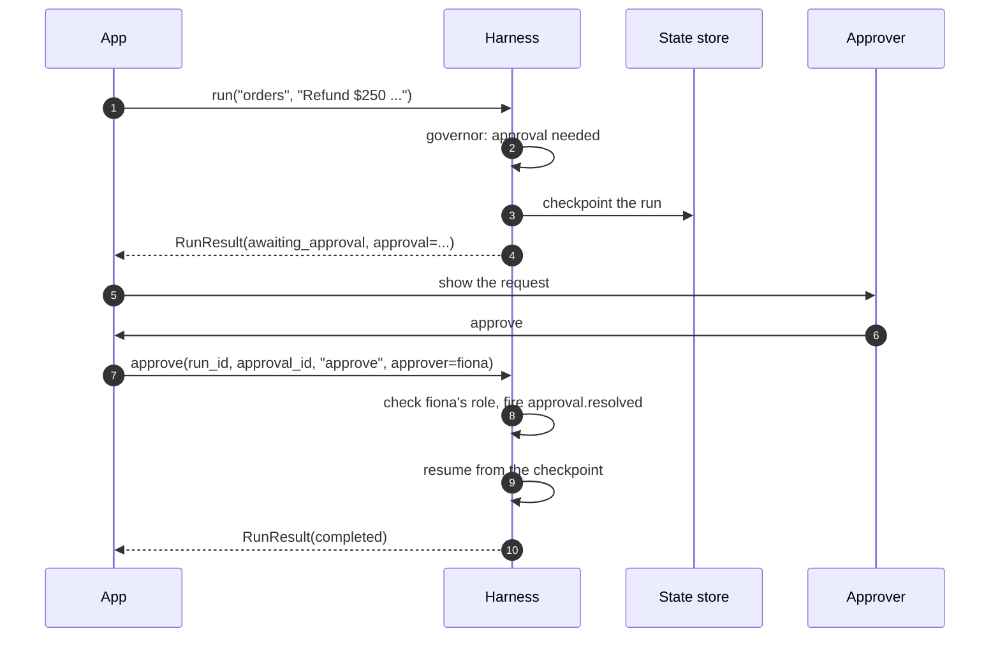

# Approvals

Some calls shouldn't be decided by a rule alone: a $250 refund is fine if someone in finance agrees. When a step needs a person, the run **suspends**. Its state is saved, an approval request goes out, and the run waits. When an approver answers, the run continues exactly where it stopped, even in another process.

## Ask for approval

Add a third rule, and say who approves:

```yaml title="harness.yaml (policy and approvals)" hl_lines="10-17"
--8<-- "docs_src/tutorial/approvals/harness.yaml:44:60"
```

`require_approval` sends the call to a person. `approvals.approver_role` says whose job that is when the step that asked doesn't say, and `timeout` is how long the request stays open.

## Suspend, then approve

```python title="main.py"
--8<-- "docs_src/tutorial/approvals/main.py"
```

```console
$ HARNESSWEAVER_ENV=offline uv run python main.py
awaiting_approval
waiting for finance: refunds over $100 need a person from finance
tool call: refund_payment {'order_id': 'A-1001', 'amount_usd': 250}
completed
Done: the refund is on its way to your card.
```

The first `run` returned with the status `awaiting_approval` and `result.approval`, an `ApprovalRequest`: the call that's waiting, the reason, the role that may approve, and when the request expires. Your app shows it to someone in finance. `harness.approve` records their answer, and the run picks up from the pending call: the refund runs, and the model writes its reply.



## Answering

```python
await harness.approve(run_id, approval_id, decision, approver=who, edited_args=None, reason=None)
```

| Decision | Effect |
| --- | --- |
| `approve` | The call goes ahead |
| `edit` | The call goes ahead with `edited_args`, which pass through **every** governor check again |
| `reject` | The run ends `blocked`, with the code `approval_rejected` |

The harness checks that the approver holds the approver role, so `fiona` needs the `finance` role. An approval never overrides a deny: edited arguments that a rule denies are still blocked. An answer that arrives after the request expired ends the run as `approvals.on_timeout` says (`escalate` by default, or `reject`).

## What asks for approval

| Source | Example |
| --- | --- |
| A policy rule with `effect: require_approval` | The `big-refunds` rule above |
| A manifest's `approval.when` | `approval: { when: "args.amount_usd > 100", approver_role: finance }` |
| `tools.approval_by_risk` | `{ high: required, critical: required }`: every high-risk call |
| A task's `approvals.tools` | `approvals: { tools: [refund_payment] }`: always, in this task |
| The lethal trifecta, with `tools.trifecta: require_approval` | Data could leave after untrusted content and private data entered the run |
| A guard with `action: require_approval` on the output | A person checks the answer before it goes out |
| Your own middleware returning `Suspend(reason, approver_role)` | Anything your code decides |

The approver role comes from the step that asked, else the task's `approvals.approver_role`, else the spec's `approvals.approver_role`.

An approval covers one execution of the call: if the model asks for the same call again, a person is asked again. `approvals.grant_scope: run` makes it last the run instead ([Approvals in depth](../advanced/approvals.md#grants)).

## Where requests go

`approvals.use` picks the channel that is told about each request, once it and the run's checkpoint are saved:

| Channel | Does |
| --- | --- |
| `memory` | Keeps requests for your app to read (the default) |
| `callback` | Calls your function with each `ApprovalRequest` |
| `console` | Prints one line per request, for local development |
| `webhook` | POSTs each request as JSON to a URL |
| `email` | Sends each request by e-mail via SMTP (standard library only) |

Slack and an approval page are *planned*. [Providers](../reference/providers.md#approval-channels) has each channel's settings.

!!! info "Only harness-driven runs can wait"
    `harness.run` and the runners suspend and resume. In a standalone session, a wrapped agent, or TypeScript, a request for approval **escalates** instead, because the harness can't re-enter your app's code later.

## Waiting longer than a process lives

A run that waits for a person must outlive the process that started it. With the default in-memory state store it can't. The next chapter, [State and replay](state.md), moves the state to a file so a run can be approved after a restart. [Approvals in depth](../advanced/approvals.md) covers grants, how each runner resumes, and background runs.

## Recap

- A step that needs a person **suspends** the run (`awaiting_approval`), and `result.approval` says what's waiting.
- `harness.approve(...)` answers it: `approve`, `edit` (re-checked from the start) or `reject`. The run then resumes where it stopped.
- Approvals come from policy rules, manifests, risk levels, task settings, the trifecta, guards and your own middleware. None of them can override a deny.
